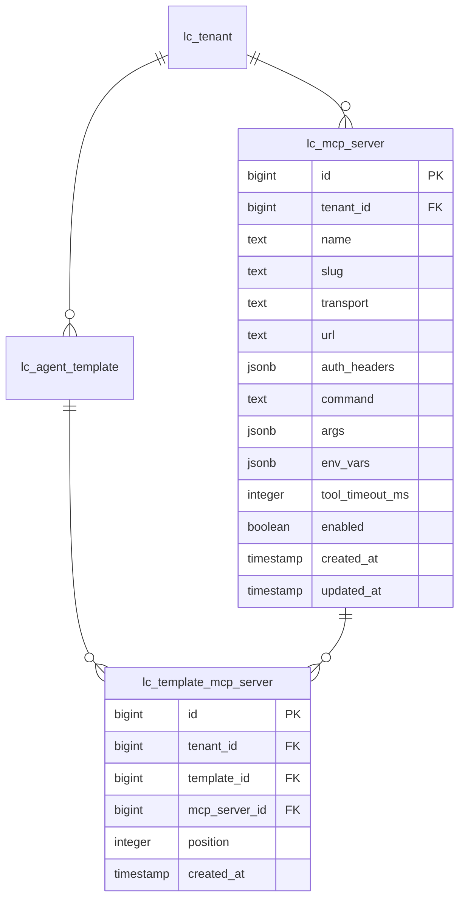

# MCP 客户端接入需求

需求标识：mcp-integration
修订号：r3
状态：review
当前授权阶段：用户已授权实施第一阶段（服务配置管理后端 + 管理页面）；模板绑定、Agent 接入与连接池未实施。
核查基线：`/home/yangcc/code/agent/loopcraft`，需求始于 `main` / `b287f93`。已核查 `agent.core.Agent`（手写循环、工具表运行期固定）、`AgentChatService.start()`（工具组装入口）、`SkillTools.forTemplate()`（模板绑定模式）、`ChatModelFactory.prepare()`（`ChatOptions.toolCallbacks()`）、`backend/pom.xml`（Java 25 / Spring Boot 4.1.1 / Spring AI 2.0.1）与 `backend/AGENTS.md` 预留的 `mcp` 包边界。
原型入口：`prototype/index.html`（r2 评审意见已应用：卡片操作按钮降噪、下拉改框架 Select 样式、传输协议显式分列）。

## 第一阶段实施记录（r3）

已实施范围：`lc_mcp_server` 建表与 `docs/database-schema.md` 同步、后端 `mcp` 包（实体/Mapper/Service/Controller/`McpProperties` stdio 开关/`McpConnectionProbe` 一次性连接探测，官方 SDK 0.17.0）、前端 `features/mcp-services`（清单页、编辑抽屉、探测结果展示）与工作区导航「插件 → MCP 服务」。未实施：`lc_template_mcp_server` 绑定表、模板编辑改造、受理探测与工具并入、常驻连接池。

实施中确定并落地的细节（相对前文的差异）：

- 权限矩阵按「成员只读，负责人与平台管理员可管理」实施（对齐模型接入页），未沿用 Skill 管理的全员可管；待用户复核。
- 鉴权头值**加密入库**：复用 `llm` 的 `LlmCredentialCipher`（AES-256-GCM，租户作 AAD），不再按"明文+不回显"处理；主密钥属性仍为 `loopcraft.llm.encryption-key`，加密组件待第三个使用方出现时上移 `shared`。
- `auth_headers`、`args`、`env_vars` 用 `text` 列存 JSON 而非 `jsonb`：MyBatis-Plus 字符串直写与 PostgreSQL jsonb 参数类型不兼容，合法性由服务层校验兜底。
- 连接探测为一次性握手 + 工具清单（5 秒超时，用完即关），提供 `POST /mcp-servers/test`（未保存表单）与 `POST /mcp-servers/{id}/test`（已保存配置，密文服务端解密）两个入口；探测失败以 `ok=false` 业务结果返回，不抛错。
- 前端测试基建：新增 `bunfig.toml` 的 test preload 预置文档全局（Radix 的 SSR 守卫在模块导入期读取 `globalThis.document`，否则弹层在测试进程静默不渲染），`tests/support/dom.ts` 按测试窗口补齐 `DocumentFragment`、`ResizeObserver`、`NodeFilter`、`MutationObserver`、`CustomEvent` 等全局。

预览命令（仓库根目录）：

```sh
python3 -m http.server 5189 --bind 127.0.0.1 --directory design/requirements/mcp-integration/prototype
```

地址：`http://127.0.0.1:5189/`。端口冲突时改用空闲端口。

## 已确认范围（用户已逐条选定）

1. **定位：仅客户端。** LoopCraft 连接外部 MCP Server，把其工具接入手写 ReAct 循环；不把 LoopCraft 自身能力暴露为 MCP Server。与 `backend/AGENTS.md` 预留的 `mcp` 包边界一致。
2. **传输：全都要，且显式分列。** Streamable HTTP（新协议）与 HTTP+SSE（老协议）是表单中两个独立选项，用户显式选择，连接按所选协议执行，不做自动回退；stdio 本地子进程也支持。
3. **stdio 权限：租户可配 + 总开关默认关。** 能力由 `loopcraft.mcp.stdio.enabled` 控制，默认关闭，dev 环境显式打开；打开即接受「租户管理员可促使后端在本机执行命令」的边界。沙箱能力成熟前不开放生产。
4. **配置存储：数据库表，租户归属。** 每租户维护自己的 MCP Server 清单；新增表须同步产出 `docs/database-schema.md` ER 图。
5. **工具暴露粒度：模板绑定 server。** 沿用 `TemplateSkill` 模式：模板绑定若干 MCP Server，运行时把绑定 server 的全部工具（带前缀命名）并入本次运行白名单。
6. **绑定服务不可用：拒绝受理，快速失败。** 提交对话时探测绑定 server，任一不可用即拒绝（503，指明哪个 server、什么原因），不降级运行。
7. **连接生命周期：常驻复用 + 空闲回收。** 按（租户, server）维护长连接与工具清单缓存，重连后刷新；超时空闲回收，stdio 连带关闭子进程。
8. **SDK 路线：官方 MCP Java SDK + 自写适配。** 引 `io.modelcontextprotocol.sdk:mcp`，握手、能力发现、`ToolCallback` 适配、连接池全部自己写在 `mcp` 包；不用 `spring-ai-mcp` 的 starter 自动装配。
9. **停用/删除联动：停用拒绝受理，删除阻止。** 停用后绑定保留，受理时报「服务已停用」拒绝（与不可用同路径）；删除时有模板绑定则阻止并列出模板，需先解绑。
10. **超时覆盖：支持按服务设置 toolTimeoutMs。** 留空用全局 `RunBudget.toolTimeout`（默认 15s）；设置后取覆盖值与 run 剩余时间的较小值。

## 背景事实（代码已核实，不重复讨论）

- Agent 循环工具表是 `AgentRequest.tools`（`Map<String, ToolCallback>`），运行开始前固定；接入点在 `AgentChatService.start()` 组装工具表处，MCP 工具以 `ToolCallback` 形态并入即可，循环本体不需要改动。
- 现有预算机制：每次工具调用套 `RunBudget.toolTimeout`（默认 15s）；工具结果经 `ToolResults` 封装并按 `maxToolResultChars`（默认 8000 字符）截断；未知工具回填错误观察而不执行。
- MCP 官方 Java SDK 与 Spring AI 的 `spring-ai-mcp` 模块均支持 stdio / SSE / Streamable HTTP 三种客户端传输；SDK 路线待定（见待定项）。

## 功能行为细则

以下条目按已确认范围展开为可实施规则；标注「建议」的细节尚未经用户确认。

### 服务配置管理

- 租户内 CRUD MCP Server 记录：名称、租户内唯一 slug、传输类型（远程 HTTP / stdio）、传输参数、启用状态。
- 传输类型取值三项：`HTTP_STREAMABLE` / `HTTP_SSE` / `STDIO`，用户显式选择，不自动协商回退。远程服务字段：URL、鉴权头（名/值对，静态 token）、可选工具超时 `toolTimeoutMs`。鉴权头值入库但**永不回显完整值**（编辑时留空表示不变），日志与事件不输出。
- stdio 服务字段：命令、参数、环境变量、可选工具超时 `toolTimeoutMs`。前端在总开关关闭时禁用 stdio 选项并说明原因；后端受理 stdio 配置时校验开关，关闭即拒绝（建议：与前端提示同文案）。
- 列表页展示：名称、传输徽章、连接状态（未连接 / 已连接·N 个工具 / 不可用·原因摘要 / 已停用 / stdio 未启用）、工具数、更新时间。
- 「测试连接」动作：保存前后均可触发，执行 initialize 握手 + tools/list，展示协议版本、server 名称与版本、工具清单；失败展示原因。测试结果不改变连接池状态（建议）。
- 权限沿用 Skill 管理确认的矩阵：当前租户普通成员与负责人均可管理（建议，待用户复核）；正式接口须同时校验身份、租户与归属。

### 连接生命周期

- 连接池按（tenantId, serverId）维护；首次需要时建立：initialize 握手 → 协议版本协商 → tools/list → 缓存工具清单。
- server 支持工具变更通知（`notifications/tools/list_changed`）时刷新缓存；不支持时以重连或手动测试连接为刷新途径（建议）。
- 空闲超过阈值回收连接（建议 30 分钟，做成配置项）；回收时 stdio 连带销毁子进程。运行中的调用不受回收影响。
- 断连后下一次需要时重建；重建失败按「不可用」处理。

### 工具暴露与命名

- 工具全名 `mcp__<serverSlug>__<toolName>`（业界惯例，防跨 server 与内置工具冲突）；描述与参数 schema 由 tools/list 结果转换。
- 受理时解析模板绑定 → 取各 server 工具快照 → 与内置工具（`list_skills` / `read_skill`）合并为本次运行白名单；运行期内固定，不追随 server 端变更。
- 同名冲突（理论可能：slug 改名后撞车）在受理时拒绝并指明冲突（建议）。

### 受理快速失败与循环内行为

- 提交对话时并行探测所有绑定 server（建议：每个握手超时 5s）；任一不可用（连接失败、握手失败、已停用、stdio 未启用）即拒绝受理，响应指明全部失败项与原因。
- 循环内复用现有 `RunListener` 事件流（`tool_called` / `tool_finished` 带前缀全名），不新增 MCP 专属事件类型。
- MCP 工具调用超时：未覆盖时套全局 `RunBudget.toolTimeout`；server 设置 `toolTimeoutMs` 后取覆盖值与 run 剩余时间的较小值。结果截断沿用 `maxToolResultChars`。可预期协议错误（工具报错、非法参数）回填错误观察交给模型修正；连接级意外异常按现有 `TOOL_EXECUTION_UNCERTAIN` 语义终止运行。

### 停用与删除联动（用户已确认）

- 停用：绑定行保留，模板编辑页显示警告；受理时按「服务已停用」拒绝，与不可用同路径、同提示结构。
- 删除：任一模板仍绑定该 server 时阻止删除，响应列出绑定它的模板名；解绑后才能删除。不做级联解绑，不做软删除。

## 实现路线（用户已确认）

- 依赖引入 `io.modelcontextprotocol.sdk:mcp`（官方 Java SDK，含 stdio / SSE / Streamable HTTP 客户端传输）；不引入 `spring-ai-mcp`。
- `mcp` 包内自建：传输配置解析 → 连接池（initialize 握手、协议协商、tools/list 缓存、list_changed 刷新、空闲回收、断连重建）→ 工具适配（`mcp__<slug>__<tool>` → Spring AI `ToolCallback`，参数 schema 转换、结果截断、错误观察封装）。
- `AgentChatService.start()` 组装工具表时合并 `SkillTools.forTemplate()` 与 MCP 绑定服务解析结果；受理探测失败抛出 503。
- 循环本体（`agent.core.Agent`）不改。

## 表结构建议（待评审）

- `lc_mcp_server`：`id`、`tenant_id`、`name`、`slug`（租户内唯一）、`transport`（HTTP_STREAMABLE / HTTP_SSE / STDIO）、`url`、`auth_headers`（jsonb，凭证，不回显）、`command`、`args`（jsonb）、`env_vars`（jsonb）、`tool_timeout_ms`（可空，空=用全局值）、`enabled`、`created_at`、`updated_at`；运行时状态（连接状态、工具数、最近错误摘要）不作为真相源入库，仅内存维护（建议）。
- `lc_template_mcp_server`（命名对齐现有 `lc_template_skill` 的 `lc_<主对象>_<被绑对象>` 风格）：`id`、`tenant_id`、`template_id`、`mcp_server_id`、`position`、`created_at`；唯一约束（`template_id`, `mcp_server_id`）。建表文件放 `sql/mcp/create_mcp_server.sql` 与 `sql/template/create_template_mcp_server.sql`。



## 页面与主要流程（原型覆盖）

1. **MCP 服务管理页**：卡片列表 + 新建/编辑（传输类型切换表单、鉴权头不回显、stdio 开关关闭时的禁用态）+ 测试连接结果 + 工具预览 + 停用/启用/删除。
2. **模板编辑页**：技能绑定旁新增「MCP 服务绑定」区块（勾选、排序、失效警告）+ 运行时工具预览（内置与各 server 工具合并，带前缀全名）。
3. **发起对话模拟面板**：选模板发消息；绑定服务不可用时展示拒绝受理响应（哪个 server、什么原因），正常时展示受理与事件流时间线。

## 验收场景草案（随讨论更新）

- 远程服务：握手成功发现工具、工具调用成功、工具报错回填观察、连接超时拒绝受理。
- stdio：开关关闭时配置被拒绝；打开后握手、调用、空闲回收关闭子进程。
- 绑定语义：模板绑定多个 server 工具全部并入；未绑定 server 的工具不在白名单（模型调用得到 UNKNOWN_TOOL 观察）。
- 循环边界：MCP 工具超时计入运行预算；截断按全局上限；意外连接异常终止运行。
- 隔离：跨租户不可见、不可配、不可绑定；凭证不回显、不落日志。
- 测试全部使用假 MCP server（本地 HTTP 桩 / 受控子进程），不请求外部真实服务。

## 待定项

- 第二阶段范围确认：`lc_template_mcp_server` 绑定表、模板编辑的 MCP 绑定区块、受理快速失败探测、工具并入白名单、常驻连接池与空闲回收。
- MCP 服务管理权限矩阵已按「成员只读」实施（见实施记录），待用户复核是否改为 Skill 式全员可管。
- OAuth 授权流：第一期仅静态鉴权头；MCP 规范的 OAuth 流程暂不做，后续有需求再议。
- 沙箱：stdio 生产化前的隔离方案（容器/独立 runner），仅记录方向。
- 同一 server 的并发调用上限与排队策略；空闲回收时长、握手超时的默认值。
- 凭证加密组件 `LlmCredentialCipher` 上移 `shared` 并拆分属性命名的时机。
- 内置 Skill 与 MCP 工具在系统提示中的呈现方式（是否需要统一目录工具）。
