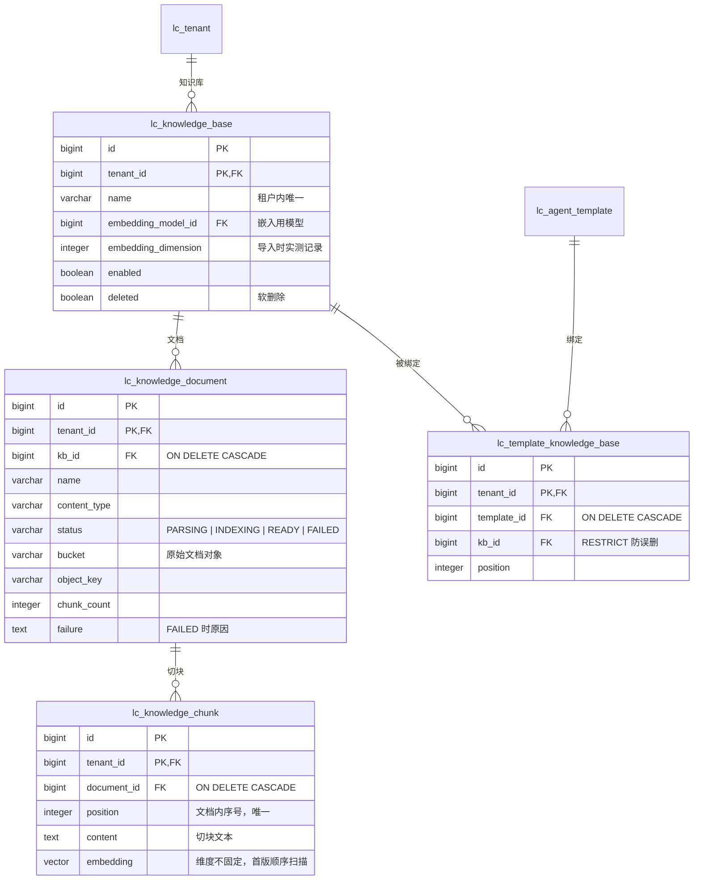

# 知识库调研：LoopCraft 的 RAG 形态与主流实现方式

调研日期：2026-10-25。范围：本仓库当前代码；本地 `harness-references/` 五个参考仓库中与知识、记忆、检索相关的设计（定向静态阅读）；业界方案（OpenAI / Anthropic 托管 API、Dify、RAGFlow、pgvector、embedding 与 rerank 模型生态、Spring AI 向量模块）来自公开文档与社区资料的网络调研。

本文回答三个问题：**知识库在 LoopCraft 应该是什么形态、落在循环的哪个位置；主流实现有哪些可借鉴的结构；落地前有哪些必须拍板的决策。** 结论与建议均为待讨论内容，不是已批准实现。

范围界定：本文的「知识库」指租户上传文档 → 解析切分 → 向量化索引 → Agent 循环内检索工具，即 RAG。从对话中自动提炼的「长期记忆」（参考仓库中 oh-my-pi / CCB 的 memory 系统）是另一个功能，与多轮会话绑定，本文仅在 harness 对比一节涉及。

证据边界：网络资料以调研当日为准，各产品参数可能随版本变化；参考仓库为本地快照，未运行验证。

## 1. 核心结论

1. **知识库是工具面能力，不触碰循环本体。** 形态为：租户建知识库、传文档，索引后通过内置检索工具（如 `knowledge_search`）进入 ReAct 循环，由模型自主决定何时检索。接入点与 Skill 工具完全同构——`AgentChatService` 构建本次运行固定工具表的那一行旁边再加一组工具即可，`agent.core` 不动。
2. **基础设施复用度高。** 对象存储上传（`FileStorage`）、租户隔离与软删除（skill 模块模式）、加密凭证按需解密（`ChatModelFactory` 模式）、工具结果截断 envelope（`ToolResults`）均有现成先例；真正新增的只有「文档解析切分」和「向量检索」两块。
3. **向量存储建议用 pgvector，不引入独立向量库或检索服务。** LoopCraft 已运行 PostgreSQL 17，pgvector 的迭代索引扫描、halfvec、混合检索能力已覆盖生产 RAG 常见形态；单机学习项目引入 Qdrant/Milvus/RAGFlow 属于运维负担。Spring AI 2.0 的 `spring-ai-starter-vector-store-pgvector` 是「全局单 VectorStore + 全局 EmbeddingModel bean」的自动装配设计，还依赖 JdbcTemplate，与本仓库按租户动态解密构建模型实例的模式冲突；建议只用 `spring-ai-openai` 中已有的 EmbeddingModel 客户端（OpenAI 兼容 `/embeddings`），向量列读写由 MyBatis-Plus 手写 SQL 自管，这与现有技术栈和学习目标一致。
4. **两个方向性分歧需要先拍板：** embedding 模型如何建模（现有 `lc_llm_model` 无 chat/embedding 类型区分）；知识库是否像 Skill 一样做不可变版本化。两者决定表结构，见第 7 节。
5. **建议最小闭环先行：** Markdown/纯文本文档 + 固定长度切分 + 纯向量检索 + 模板绑定知识库。混合检索（BM25）、rerank、PDF/DOCX 解析、父子分段列为第二阶段。全程可用假 embedding 桩测试，不依赖真实模型。

## 2. LoopCraft 现状盘点

以下均为当前代码事实：

- **工具面（知识库的接入点）**：`tool/SkillTools.forTemplate(tenantId, templateId)` 按模板解析技能绑定快照，构建 `Map<String, ToolCallback>`（当前含 `list_skills` / `read_skill`）；`AgentChatService` 第 99 行调用它并把工具表传入 `ChatModelFactory.prepare`，随 `AgentRequest` 在运行开始前固定。`ToolExecutor` 负责白名单查找与错误观察回填；`ToolResults` 的 envelope 携带 `ok` / `truncated` 标志，截断上限来自 `AgentProperties.maxToolResultChars`。
- **模型面**：`llm/service/ChatModelFactory` 按模板引用校验租户模型与来源，解密 API Key（AES-256-GCM，`LlmCredentialCipher`），动态构建 `OpenAiChatModel`（同步与 async client 显式构建，凭证只留在 client 实例内，不注册全局 Bean）。依赖为 `spring-ai-openai` + `spring-ai-anthropic`（Spring AI BOM 2.0.1），无任何向量相关依赖。
- **模型目录缺口**：`lc_llm_model` 的能力字段只有 `context_limit` 与 `temperature_*`（`backend/sql/llm/add_model_capabilities.sql`），没有模型类型（chat / embedding / rerank）区分。知识库需要 embedding 模型，接入前须解决此缺口。
- **存储面**：`storage/service/FileStorage` 提供 upload / stat / open / delete / presignDownload，桶与 key 由业务决定；skill 模块展示了完整的对象生命周期样板——版本化整包（`lc_skill_version` 记录 bucket/object_key）、上传对象跟踪与清理补偿（`lc_skill_object_upload`）、包体校验（ZIP ≤ 20 MiB、≤ 200 文件、单文件 ≤ 2 MiB）、软删除与版本锁定（`lc_template_skill` 用 `version_number` 锁定 + RESTRICT 防删）。
- **表结构模式**：业务表统一 `lc_` 前缀、`tenant_id` 复合主键/外键、模板与能力的绑定用关联表（`lc_template_skill` 带 position）、中文 COMMENT、SQL 按模块目录手动维护（见 `docs/database-schema.md`）。
- **前端**：侧栏分组为「Agent（模板配置、模型接入）/ 插件（技能管理、MCP）/ 租户配置 / 平台管理」，`frontend/src/features/portal/IdentityWorkspace.tsx`。知识库管理页自然落在「插件」或「Agent」分组，交互可参照技能管理（列表 + 详情 + 上传）。
- **进行中的关联需求**：MCP 客户端接入共创中（`design/requirements/mcp-integration/`，`lc_mcp_server` + `lc_template_mcp_server`）。知识库内置工具与 MCP 动态工具将并存于同一工具表，命名规范（内置 `knowledge_search` vs MCP `mcp__<slug>__<tool>`）已天然区分，不冲突。
- **其他缺口**：无 token 计数器（上下文压缩调研同样指出）；多轮会话未落地——知识库不依赖会话，可独立实施；检索结果作为工具结果，未来受压缩层级 2（旧工具结果清理）管理。

## 3. 业界主流形态

### 3.1 托管 API 的两极

| 方案 | 切分 | 索引与检索 | 说明 |
| --- | --- | --- | --- |
| OpenAI file_search（vector store） | 上传后自动解析切分，默认 800 token / 400 重叠，可自定义 100–4096 | 托管向量索引 + file_search 工具，支持过滤与 ranker | 全托管，改切分策略需重新添加文件 |
| Anthropic Files API | 无 | 纯文件存储，无检索 | 官方建议自建检索，并发表 contextual retrieval 方法 |

Anthropic 的 contextual retrieval 是当前检索质量的代表性结论：切分前用 LLM 为每个 chunk 生成一段「该块在全文中的上下文说明」前缀再嵌入，配合 BM25 混合检索与 rerank，可把 top-20 检索失败率从 5.7% 降到 1.9%。代价是每 chunk 一次额外的 LLM 调用，适合对召回敏感的场景，作为 LoopCraft 二阶段候选。

### 3.2 开源平台的通用流水线

Dify 与 RAGFlow 代表两种取舍，流水线同为「解析 → 切分 → 索引 → 检索（→ rerank）」四段：

- **Dify**：知识库为一级实体，支持自动/自定义/父子分段（parent-child chunking，小块检索、大块喂给模型）；索引分「高质量（embedding）」与「经济（仅关键词）」；检索设置三档——向量、全文、混合，混合之上可选接第三方 rerank 模型（Cohere、Jina 等）。
- **RAGFlow**：主打 DeepDoc 深度文档理解，布局感知解析复杂格式（表格、扫描件），按文档类型提供切分模板（通用、Q&A、简历、法律、论文、表格、书籍），强引用归因。

对 LoopCraft 的启示：四段流水线中「解析 + 切分」是工程量大头（Java 侧 PDF/DOCX 需引入 PDFBox/POI 类依赖），首版用 Markdown/纯文本绕开；「检索三档 + rerank」的配置面先不做，固定单一策略，把结构留出扩展位。

### 3.3 检索质量共识

- chunk 大小主流落点 300–1000 token（OpenAI 默认 800/400），结构化文档优先按标题/段落边界切；
- 混合检索（向量 + BM25 关键词）优于单一向量检索，中文场景 BM25 分词需要额外处理（pg_trgm 或外部分词）；
- rerank 是精度增益最大的一跳，但多一次模型调用；开源代表 BGE-M3（dense + sparse + multi-vector 三合一，MIT）与 Qwen3-Reranker，商用代表 Cohere / Voyage；
- embedding 模型：OpenAI text-embedding-3 系列走 API 最省事；开源侧 Qwen3-Embedding（MTEB 多语言榜首）与 BGE-M3 都有 OpenAI 兼容托管端点，中文效果好。LoopCraft 模型接入是租户自配 OpenAI 兼容连接，embedding 模型可直接复用该通道。

## 4. harness 侧对应物

五个参考仓库均无「用户文档知识库」，它们的对应物是注入式项目知识 + 长期记忆系统，检索式 RAG 均未进入主循环：

| 仓库 | 知识/记忆形态 | 关键文件 |
| --- | --- | --- |
| oh-my-pi | 五种记忆后端（off / local / hindsight / mnemopi / sharpshooter） | `docs/memory.md`、`docs/mnemosyne-memory-backend.md` |
| codex | AGENTS.md 分层注入 + 协议级记忆引用 | `codex-rs/core/src/agents_md.rs`、`codex-rs/protocol/src/memory_citation.rs` |
| claude-code (CCB) | memdir 分类记忆目录（user/feedback/project/reference，private/team 作用域） | `src/memdir/memoryTypes.ts`、`src/commands/memory` |
| deepseek-harness | 记忆完全外置第三方 MCP 服务 | `docs/user/guide/mcp-memory.zh.md` |
| opencode | 无自建记忆；桥接 Copilot 平台 file_search 工具 | `packages/core/src/github-copilot/responses/tool/file-search.ts` |

值得借鉴的三个设计：

1. **注入预算**：codex 的 AGENTS.md 从项目根到当前目录全量拼接，但受 `project_doc_max_bytes` 字节预算约束；oh-my-pi 记忆注入 system prompt 有 token 上限（默认 5000）。知识库检索结果作为工具结果进入上下文，天然受工具结果截断与未来的上下文压缩管理，不需要单独预算机制。
2. **引用结构**：codex 的 `MemoryCitation`（path + 行号 + note）把「知识来自哪里」做成协议级结构。`knowledge_search` 的返回值应携带文档名与位置，让模型可引用出处——这也是 RAGFlow 强调的引用归因。
3. **内置还是外置**：DSH 把记忆整个交给 MCP 生态，只负责连接与工具暴露；opencode 桥接平台的托管检索。对 LoopCraft 而言内置工具是主路径（租户开箱可用），远期把知识库检索以 MCP server 形态对外开放（LoopCraft 作为 MCP 服务端供外部 harness 接入）是自然延伸，与当前 MCP 客户端需求不冲突。

oh-my-pi 的 mnemopi 是 harness 侧最完整的检索实现：SQLite 内 FTS + 向量 + 情节图 + 事实 + 时间五路召回按倒数排名融合（"polyphonic recall"），embedding 用本地 bge-base-en-v1.5（768 维）或 e5-large（1024 维），可降级 FTS-only。它印证了混合检索的价值，也展示了「自建小型检索引擎」的复杂度——不建议 LoopCraft 走这条路。

## 5. 技术选型分析

### 5.1 向量存储：pgvector

- 已有能力：HNSW/IVFFlat 近似索引；0.8.0 起迭代索引扫描（iterative scan）解决「向量检索 + 过滤条件」漏召回问题——租户隔离查询（`WHERE tenant_id = ? AND kb_id = ? ORDER BY embedding <=> ?`）正属此类；halfvec 半精度减半存储、并行 HNSW 构建；与 PostgreSQL 事务、备份、`check.sh integration` 的测试设施同栈。
- 不选专用向量库（Qdrant/Milvus/Weaviate）：新增常驻服务与运维面，单机学习项目收益为零。
- 不选外置检索引擎（RAGFlow/Elasticsearch）：同上，且会把切分-索引-检索链路移出本项目学习视野。
- 落地前提：本地 `scripts/dev.sh db` 的 PostgreSQL 17 容器需预装 pgvector 扩展（镜像带 pgvector 的 tag 或自建镜像；本机容器镜像拉取受限已有先例，见缓存镜像约定）。SQL 依旧手动维护：`CREATE EXTENSION vector` 与建表同文件。

### 5.2 Spring AI 的适配问题

Spring AI 2.0 提供 `spring-ai-starter-vector-store-pgvector`（自动装配 `PgVectorStore`，要求 JdbcTemplate 与全局 EmbeddingModel bean）。三个不匹配：全局单 store vs 知识库各自绑定不同租户的 embedding 模型；starter 的 JDBC 依赖 vs 项目 MyBatis-Plus 技术栈；自动装配的隐藏度 vs 「循环与链路保持显式」的项目目标。

建议：不引入该 starter。embedding 走 `spring-ai-openai` 已有依赖中的 `OpenAiEmbeddingModel`，按 `ChatModelFactory` 同款模式在文档导入时按知识库解析构建、用完即弃；chunk 的向量读写（`<=>` 距离、批量插入）用 MyBatis-Plus 手写 SQL（属于后端 AGENTS 已许可的「数据库专用能力」场景），类型安全与可测试性更好。

### 5.3 维度问题

pgvector 列可声明固定维度（可建 HNSW 索引，维度上限 2000，halfvec 4000）或不带维度（不可建索引，顺序精确扫描）。不同 embedding 模型维度不同（768 / 1024 / 1536 / 3072）。首版建议：**chunk 表维度不固定 + 顺序扫描**——单租户文档量级下精确 KNN 足够，且允许每个知识库自由换 embedding 模型（换模型全量重嵌入是必然成本，维度不应再加一层限制）；数据量上来后再按主导维度建固定列或 halfvec 索引，迁移路径清晰。

### 5.4 embedding 模型接入

复用 `lc_llm_source` / `lc_llm_model`：租户在现有「模型接入」里配 OpenAI 兼容连接，embedding 模型作为目录中的一行。缺口是模型类型区分，两个方案（详见第 7 节决策点）：`lc_llm_model` 加能力列（如 `model_type`，chat / embedding），或最小化不动现有表、知识库直接引用模型行并在导入时实测探测（调一次 `/embeddings` 验证可用与维度）——探测成本一次，且与「连接探测」的既有交互一致。

## 6. 表结构与工具面草案（示意，未定稿）

按现有命名与约束模式的最小草案。实施时须同步更新 `docs/database-schema.md` 的 ER 图与表清单，本节草图仅用于评审：

工具面：模仿 `SkillTools` 增加 `KnowledgeTools.forTemplate(tenantId, templateId)`，返回 `list_knowledge_bases` + `knowledge_search`（query、topK；返回 chunk 内容、文档名、位置与得分，走 `ToolResults` envelope 截断）。受理校验：模板绑定的知识库停用或删除时运行明确失败，与技能绑定语义一致；embedding 模型不可用同 503 处理。

事件与观测：工具调用已有 `tool_called` / `tool_finished` 事件且不含工具参数与结果内容，知识检索天然满足脱敏纪律；文档导入（解析 + 嵌入）是长任务，需要异步状态位（status 列）+ 失败原因，交互模式参照 Skill 保存的幂等请求保护。

## 7. 决策点清单

1. **embedding 模型建模**：`lc_llm_model` 加 `model_type` 列（改列，需同步 database-schema），或知识库引用模型行 + 导入时实测探测（不动现有表）。
2. **知识库版本化**：Skill 的不可变整包版本模式是否复制到文档级（每次替换文档生成新版本 + 绑定锁定版本），还是文档级最新态（简单但重建索引期间有中间态）。建议首版不版本化、只做替换重嵌入，绑定表不带版本列。
3. **切分策略**：首版固定 token 长度（建议 512/64 重叠，无 token 计数器前按字符近似）还是 Markdown 结构感知（标题边界优先）？Markdown 是当前 Skill 的既有格式，结构感知实现成本低、增益明显。
4. **检索策略**：首版纯向量 top-K（K 默认 5）？BM25 混合检索涉及中文分词，建议明确推后。
5. **文档格式范围**：首版 Markdown / 纯文本（UTF-8 校验即可），PDF / DOCX 依赖与解析质量单独一节再议。
6. **上传约束**：单文件与单知识库的体积/数量上限（参照 Skill 的 20 MiB / 200 文件量级）。
7. **循环内还是运行外注入**：本文全程按「循环内工具」设计（模型自主检索）；另一种「受理时固定检索结果拼进 prompt」的运行外形态存在，但会让模型失去多轮检索能力，不建议。
8. **重嵌入触发**：换 embedding 模型后旧向量失效，是阻止切换（有文档时不可换模型）还是允许并要求手动重建？

## 8. 建议路径（待讨论）

1. **第一阶段（最小闭环）**：pgvector 扩展进本地数据库设施 → 三张业务表 + 模板绑定表 → Markdown/纯文本上传（限流约束）+ 固定切分 → 假 embedding 桩驱动的导入链路测试 → 真实 OpenAI 兼容 embedding（按租户连接动态构建）→ `knowledge_search` / `list_knowledge_bases` 内置工具接入现有工具表 → 模板配置页「工具」页签增加知识库绑定。全程不触碰 `agent.core`，普通检查用假模型与本地 HTTP 桩，数据库行为走 `check.sh integration`。
2. **第二阶段（质量与格式）**：Markdown 结构感知切分、引用归因进答案事件、BM25 混合检索（中文分词选型单独讨论）、rerank 接入（复用模型接入通道）、PDF/DOCX 解析依赖、contextual retrieval（可选）。
3. **远期关联**：多轮会话落地后，检索结果作为工具结果纳入上下文压缩管理；知识库检索以 MCP server 形态对外开放。

按仓库约定，工具执行与模型解析的循环本体保持由用户掌控；本功能全部落在工具面、模型接入面与平台面。

## 参考来源

- [Spring AI PGvector 文档](https://docs.spring.io/spring-ai/reference/api/vectordbs/pgvector.html)、[Maven Central: spring-ai-starter-vector-store-pgvector](https://central.sonatype.com/artifact/org.springframework.ai/spring-ai-starter-vector-store-pgvector)
- [pgvector 仓库（迭代扫描、halfvec）](https://github.com/pgvector/pgvector)、[Crunchy Data: Postgres 混合向量检索](https://www.crunchydata.com/blog/hybrid-vector-search)
- [OpenAI 社区：vector store 自动切分](https://community.openai.com/t/openai-vector-stores-is-chunking-still-required-or-does-openai-do-it-for-me/1366213)、[Azure OpenAI vector stores（默认 800/400）](https://learn.microsoft.com/en-us/rest/api/microsoft-foundry/azureopenai/vector_stores)
- [Anthropic: contextual retrieval](https://www.anthropic.com/research/contextual-retrieval)
- [Dify 文档：索引方法与检索设置](https://docs.dify.ai)
- [RAGFlow 仓库](https://github.com/infiniflow/ragflow)
- [PremAI: BGE-M3](https://www.premai.io)、[Qwen3-Embedding](https://qwen.ai)
