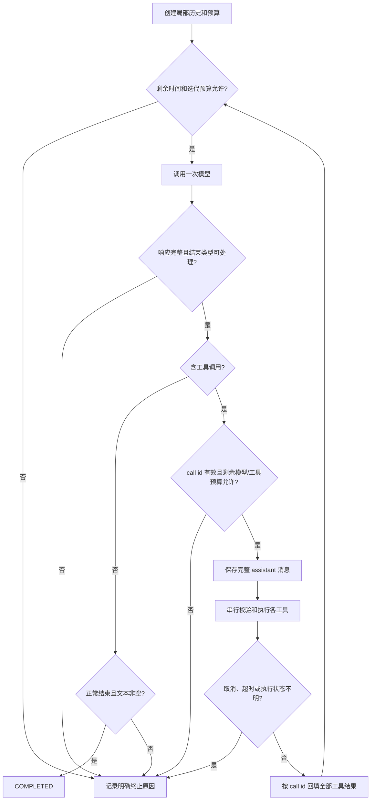

# ReAct Agent 主流程：Harness 源码调研与 LoopCraft 能力取舍

状态：**核心循环已实现并提交；外围通道（受理 + SSE + Redis Stream + 运行持久化）已实现，待用户确认提交**

调研日期：2026-10-18；2026-10-25 按当前代码对齐起点与模型接入方式，拍板第 12 节全部决策，同日多次修订：D6/D12 改为 Skill 只读工具；交互形态几经讨论（同步 → SSE 异步任务 + Redis Stream）后**范围收缩为核心与外围两块**——首版只做核心循环能力 + 同步最小接口（D2 回同步），SSE、Redis Stream、会话、消息持久化、OpenAPI 归入外围后续设计（见第 10 节）。

调研方式：阅读本地五个参考仓库的固定提交、LoopCraft 当前文件，以及 Spring AI 2.0.1 源码。未运行参考项目、参考测试或真实模型。

## 1. 建议先确定什么

建议 LoopCraft 第一阶段做一个**项目自己驱动、单次请求内运行、工具串行执行、有明确预算和终止结果的 ReAct 循环**。

保留 Spring AI 的模型、消息和工具描述类型；模型每次只调用一次，执行哪些工具、何时再调用模型、何时停止，由 LoopCraft 显式决定。第一阶段用两个无副作用的只读 Skill 工具（list_skills / read_skill）把链路跑通，再考虑业务工具和交互体验。

本次建议的核心取舍：

| 问题 | 推荐选择 | 原因 |
| --- | --- | --- |
| 谁拥有循环 | LoopCraft 手写循环 | 主流程可见，符合项目的学习目标 |
| 如何理解 ReAct | 使用原生 Function Calling 组织模型 → 工具 → 观察结果 | 不解析自由文本里的 `Thought/Action`，不要求输出或展示隐藏思维链 |
| 模型调用方式 | 先完整响应，再判断和执行工具 | 避免流式碎片、截断参数和执行竞态一起进入首版 |
| 一次返回多个工具 | 支持，按返回顺序串行执行 | 能覆盖真实协议，又暂不承担并发调度复杂度 |
| 状态存在哪里 | 本次请求的局部内存 | 当前需求是主循环，已有数据库不构成保存会话的理由 |
| 常见工具输入错误 | 转成明确的失败观察结果，让模型在预算内修正 | 保留 Agent 的纠错能力，不把工具错误冒充成功 |
| 模型请求失败、超时 | 明确终止，首版不自动重试 | 避免重试嵌套、隐性成本和重复执行 |
| 达到轮次上限 | 硬停止，不额外请求“总结一次” | 预算容易解释和验证 |
| 高级能力 | 暂缓并发、SSE、运行中插话、Hooks、压缩、持久化恢复和子 Agent | 先验证核心闭环；以后按具体场景增加 |

第 1 节取舍与第 12 节 D1–D14 已于 2026-10-25 对话拍板确认；开工前以第 13 节建议顺序另行确认实施范围。

## 2. LoopCraft 当前真实起点

（2026-10-25 更新）本节以当前工作区与已提交代码为准。调研初稿描述的 `Agent.java`、`AgentController.java`、`AgentProperties.java` 与 `application-llm.yml` 是当时未提交的工作区文件，现均已不存在，也未进入 Git 历史。

| 当前模块/文件 | 已有能力 | 与 ReAct 循环的关系 |
| --- | --- | --- |
| `llm` 模块（`LlmSource`、`LlmModel`、`LlmAccessService`、`LlmCredentialCipher`、`LlmModelDiscovery`） | 租户级供应商连接（OPENAI_COMPATIBLE / ANTHROPIC_COMPATIBLE 协议、baseUrl、加密 API Key）与模型目录（modelId、上下文上限、温度范围）的 CRUD、发现与幂等导入 | 模型输入端数据已齐；尚无把配置构建为可调用 `ChatModel` 的工厂 |
| `template` 模块（`AgentTemplate`、`TemplateSkill`） | 租户共享模板：`modelId`、`systemPrompt`、`temperature`、`maxIterations`、`timeoutMinutes` 必填，另存 `contextBudgetTokens`、`summaryModelId`、`keepRecentMessages` 与 Skill 关联（带版本号和排序） | 运行配置输入端已齐；只保存配置，不执行任务 |
| `skill` 模块（`Skill`、`SkillVersion`、`SkillObjectUpload`） | 版本化技能文档包与 RustFS 对象存储 | 首版以只读工具消费（D12） |
| `identity` / `storage` 模块 | 账号、租户、成员权限；对象存储 | 运行的权限与存储边界沿用 |
| [application.yml](../../../backend/src/main/resources/application.yml) | 无 `loopcraft.agent` 预算配置 | 模型轮次与运行时长改由模板字段提供；工具预算等全局配置在实施时新增 |
| [pom.xml](../../../backend/pom.xml)（未提交改动） | 引入 spring-ai-bom、spring-ai-openai、spring-ai-anthropic，注释明确按租户动态构建模型 | 随 ChatModel 工厂开发一并收尾提交 |

因此，本次实施是把“三个管理模块 + 空白的 agent 包”补成“按租户模板驱动的受控模型与工具循环”。数据库选型已经存在，业务会话持久化仍是另一项需求。

## 3. 调研范围和证据边界

固定以下本地源码快照，不把主分支后续更新混入结论：

| 仓库 | 本地目录 | 固定提交 |
| --- | --- | --- |
| can1357/oh-my-pi | `harness-references/oh-my-pi/` | [dd657ab3a31c](https://github.com/can1357/oh-my-pi/tree/dd657ab3a31c865efdb0c9c02ff7cd7a47c66bdf) |
| anomalyco/opencode | `harness-references/opencode/` | [8c173a8f3805](https://github.com/anomalyco/opencode/tree/8c173a8f3805d8e749d44311054b07e37a1b2ce1) |
| deepseek-ai/deepseek-harness | `harness-references/deepseek-harness/` | [687f282e8625](https://github.com/deepseek-ai/deepseek-harness/tree/687f282e8625c6b8d11ff58211a90524be2e4317) |
| openai/codex | `harness-references/codex/` | [ce0323f2f2d3](https://github.com/openai/codex/tree/ce0323f2f2d3b25e82806cd555237da3db4e1897) |
| claude-code-best/claude-code | `harness-references/claude-code/` | [77a7934e15d6](https://github.com/claude-code-best/claude-code/tree/77a7934e15d69da13879112ed7db695c9ee7a52a) |

这里的 `claude-code` 是 **claude-code-best/claude-code（CCB）第三方项目**。其 README 自述为复原和扩展项目；本次只分析该仓库代码，不据此推断 Anthropic 官方 Claude Code 的内部实现。 [源码：项目来源](https://github.com/claude-code-best/claude-code/blob/77a7934e15d69da13879112ed7db695c9ee7a52a/README.md#L13)

调研聚焦主循环、工具分发、消息回填、终止和错误边界，没有全面审计各项目全部权限、存储、模型适配与插件实现。源码里存在某项机制，不等于已验证它在所有环境下可靠。参考测试仅用于理解预期，不作为本次测试通过的证据。

## 4. 先用一个例子统一“主循环”的含义

假设模板绑定了技能 `notes-helper`（版本 3），注册只读工具 `list_skills()` 和 `read_skill(slug)`，请求是“按笔记技能的规范总结这段内容”：

```text
初始消息：system + user
第 1 次模型调用：assistant 发出 list_skills()，call_id=c1
运行时：校验并执行 list_skills，记录 tool(c1, [{"slug":"notes-helper","name":"笔记助手","description":"…","version":3}])
第 2 次模型调用：携带完整历史，assistant 发出 read_skill("notes-helper")，call_id=c2
运行时：校验并执行 read_skill，记录 tool(c2, 绑定版本 3 的文档内容)
第 3 次模型调用：携带完整历史，assistant 返回基于技能内容的最终文本
运行结束：COMPLETED，模型调用 3 次，工具调用 2 次
```

不能只把技能清单或文档结论拼进用户文本，也不能丢掉带 `c1` 的 assistant 消息。模型需要看到自己提出的调用及与它一一对应的工具结果，才能继续。演示验收用假模型固定返回上述序列，技能内容由测试预置；真实模型是否选择调用工具，不作为确定性测试条件。

本文约定：

- **run**：一次 HTTP 请求触发的一次 Agent 运行。
- **iteration**：一次模型请求以及该响应产生的工具批次；即使没有工具也计一次。
- **tool call**：模型提出的一次工具调用；同一 iteration 可以有多个。

不同参考项目的 turn、step 含义不同，不能直接把它们的计数配置搬过来。

## 5. 五个项目分别怎么做

### 5.1 oh-my-pi：显式内循环，加输入队列和扩展点

主入口在 `packages/agent/src/agent-loop.ts`。`runLoopBody` 使用两层循环：内层处理模型输出、工具调用和 steering 输入；内层准备结束后，外层检查是否还有迟到的 steering、aside 或 follow-up，存在时继续驱动。它不是只跑一个 `while(toolCalls)`。 [源码：主循环](https://github.com/can1357/oh-my-pi/blob/dd657ab3a31c865efdb0c9c02ff7cd7a47c66bdf/packages/agent/src/agent-loop.ts#L1196) [源码：输入队列](https://github.com/can1357/oh-my-pi/blob/dd657ab3a31c865efdb0c9c02ff7cd7a47c66bdf/packages/agent/src/agent-loop.ts#L1815)

主调用链可以概括为：准备上下文 → 准备并发送模型请求 → 保存 assistant 消息 → 提取工具调用 → `executeToolCalls` → 回填工具结果 → 检查是否继续。

值得借鉴的具体机制：

- 主循环同时看实际工具块和结束原因。正常 `stop` 中带工具调用也可能继续；`length` 截断、错误或中断响应不会按正常完整调用执行。对未执行调用生成带明确原因的结果，以保持调用与结果配对。 [源码：响应分流](https://github.com/can1357/oh-my-pi/blob/dd657ab3a31c865efdb0c9c02ff7cd7a47c66bdf/packages/agent/src/agent-loop.ts#L1536)
- `prepareToolCallDispatch` 先解析工具、校验参数，执行前 Hook 改过参数后再次校验，并让最终历史与真实执行参数保持一致。 [源码：执行准备](https://github.com/can1357/oh-my-pi/blob/dd657ab3a31c865efdb0c9c02ff7cd7a47c66bdf/packages/agent/src/agent-loop.ts#L3071)
- 工具分为 `shared` 和 `exclusive`，独占调用等待此前共享调用完成；这里未声明时默认 shared，不能把它概括为“所有项目都默认保守串行”。 [源码：工具调度](https://github.com/can1357/oh-my-pi/blob/dd657ab3a31c865efdb0c9c02ff7cd7a47c66bdf/packages/agent/src/agent-loop.ts#L3830)
- `deadline` 可以合并成取消信号；模型前置 gate、上下文变换和工具前后 Hook 是独立扩展点。本文没有在该主循环里找到与 LoopCraft `maxIterations` 完全等价的统一总轮次硬上限，不把局部纠错次数限制误写成总预算。 [源码：deadline](https://github.com/can1357/oh-my-pi/blob/dd657ab3a31c865efdb0c9c02ff7cd7a47c66bdf/packages/agent/src/agent-loop.ts#L1208) [源码：循环配置](https://github.com/can1357/oh-my-pi/blob/dd657ab3a31c865efdb0c9c02ff7cd7a47c66bdf/packages/agent/src/types.ts#L172)

**LoopCraft 取舍：**借鉴显式循环、完整消息和终止分流；首版不引入输入队列、工具别名补救、参数改写 Hook、推测执行或共享/独占调度。省掉的是交互和扩展机制，工具配对与截断判断仍要保留。

### 5.2 OpenCode：持久会话驱动逻辑 step，attempt 负责一次执行

本次版本的核心已在 `packages/core/src/session/runner/`，不能按旧教程寻找 `packages/opencode/src/session/processor.ts`。

`SessionRunner.drain` 从已记录的会话历史和 inbox 推进；`runStep` 拥有逻辑 step 的压缩、重试和步数策略；`SessionStep.attempt` 负责单次 provider stream、工具执行及最终事件落定。换句话说，**逻辑上的一轮与底层一次请求尝试不是同一个计数维度**。 [源码：drain](https://github.com/anomalyco/opencode/blob/8c173a8f3805d8e749d44311054b07e37a1b2ce1/packages/core/src/session/runner/llm.ts#L57) [源码：runStep](https://github.com/anomalyco/opencode/blob/8c173a8f3805d8e749d44311054b07e37a1b2ce1/packages/core/src/session/runner/llm.ts#L209)

值得借鉴的具体机制：

- 收到完整 `tool-call` 事件并发布调用事件后启动本地工具 fiber；标记 `providerExecuted` 的调用不在本地重复执行。流结束后等待工具结束，再落定 step。 [源码：attempt](https://github.com/anomalyco/opencode/blob/8c173a8f3805d8e749d44311054b07e37a1b2ce1/packages/core/src/session/runner/step.ts#L91)
- 达到配置的 steps 阈值时，保留工具定义以维持缓存前缀，但将 tool choice 设为 none；工具执行入口也拒绝调用，随后允许文本收尾。这是“限制工具、留一轮文本回答”的产品策略，不等同于禁止一切后续模型调用。 [源码：步数限制](https://github.com/anomalyco/opencode/blob/8c173a8f3805d8e749d44311054b07e37a1b2ce1/packages/core/src/session/runner/llm.ts#L226)
- 没有持久输出时可以重试原请求；已有输出时走带已完成历史的继续路径。输出截断还有单独的有限续写逻辑。 [源码：重试分流](https://github.com/anomalyco/opencode/blob/8c173a8f3805d8e749d44311054b07e37a1b2ce1/packages/core/src/session/runner/step.ts#L200) [源码：输出续写](https://github.com/anomalyco/opencode/blob/8c173a8f3805d8e749d44311054b07e37a1b2ce1/packages/core/src/session/runner/llm.ts#L290)
- 重新 drain 前会处理遗留 running/streaming 工具和未落定压缩记录，体现持久化后对异常恢复的额外责任。 [源码：遗留调用](https://github.com/anomalyco/opencode/blob/8c173a8f3805d8e749d44311054b07e37a1b2ce1/packages/core/src/session/runner/llm.ts#L362)

**LoopCraft 取舍：**借鉴“一次逻辑迭代”和“一次传输尝试”的区分，即使首版不重试也把计数语义讲清楚；首版不搬数据库事件、inbox、位置迁移和流中工具执行。建议采用硬停止，不照搬最后一次模型总结。

### 5.3 DeepSeek Harness：Session 日志驱动，turn/step 边界清楚

`ReactLoopAgent` 在 `packages/core/agent-loop/src/agent.ts`。`kick` 驱动 turn，turn 推进 step；每个 step 从 Session 日志派生模型请求，流完成后保存 assistant 消息，再调度工具。next-step 和 next-turn inbox 分别承载当前运行中的引导与后续输入。 [源码：turn](https://github.com/deepseek-ai/deepseek-harness/blob/687f282e8625c6b8d11ff58211a90524be2e4317/packages/core/agent-loop/src/agent.ts#L298) [源码：step](https://github.com/deepseek-ai/deepseek-harness/blob/687f282e8625c6b8d11ff58211a90524be2e4317/packages/core/agent-loop/src/agent.ts#L400)

值得借鉴的具体机制：

- 明确记录 `turn/start`、`step/start`、assistant、tool 和结束事件；中断流记录为 interrupted message 或 attempt，不能直接冒充正常完整响应。 [源码：step](https://github.com/deepseek-ai/deepseek-harness/blob/687f282e8625c6b8d11ff58211a90524be2e4317/packages/core/agent-loop/src/agent.ts#L400)
- 模型 finish 为 max-tokens 时先结束该 step，不执行其中的工具；正常响应没有工具则完成，有工具则执行并决定是否继续。工具可显式 `concludeTurn`，这属于工具完成语义，不是所有工具天然如此。 [源码：结束判定](https://github.com/deepseek-ai/deepseek-harness/blob/687f282e8625c6b8d11ff58211a90524be2e4317/packages/core/agent-loop/src/agent.ts#L547)
- 工具调度使用有上限的滚动池，exclusive 工具形成屏障；结果即使先后完成顺序不同，也按模型调用顺序落定。未显式声明并发安全时视为 exclusive。 [源码：工具批次](https://github.com/deepseek-ai/deepseek-harness/blob/687f282e8625c6b8d11ff58211a90524be2e4317/packages/core/agent-loop/src/tool-calls.ts#L60) [源码：并发判定](https://github.com/deepseek-ai/deepseek-harness/blob/687f282e8625c6b8d11ff58211a90524be2e4317/packages/core/tools/src/index.ts#L1311)
- 取消后停止补充待执行调用，收集已启动调用的结果，对未开始的调用记录明确的跳过结果；这比只对一个 Promise 超时更完整。 [源码：工具批次](https://github.com/deepseek-ai/deepseek-harness/blob/687f282e8625c6b8d11ff58211a90524be2e4317/packages/core/agent-loop/src/tool-calls.ts#L60)
- 请求错误交给 `agent/request-error` 策略决定是否 retry；不能因为 step 内有 `while(true)`，就说它无条件重试。本文未从该 driver 证明一个统一总 step 次数上限，LoopCraft 仍应自己落实硬预算。 [源码：请求错误](https://github.com/deepseek-ai/deepseek-harness/blob/687f282e8625c6b8d11ff58211a90524be2e4317/packages/core/agent-loop/src/agent.ts#L512)

**LoopCraft 取舍：**借鉴清楚的运行边界、按调用顺序提交结果以及取消后的停止派发；首版不引入 Session 日志投影、插件事件体系和恢复驱动器。保留一次请求的局部状态就足够。

### 5.4 Codex：turn 驱动采样，工具路由和执行策略分层

当前 Rust 主流程在 `codex-rs/core/src/session/turn.rs`。`run_turn` 反复调用 `run_sampling_request`；后者处理流式输出项，通过工具运行时执行调用并收集结果。`model_needs_follow_up` 或待处理输入都会促使外层继续；准备结束时还会运行 Stop hooks。 [源码：run_turn](https://github.com/openai/codex/blob/ce0323f2f2d3b25e82806cd555237da3db4e1897/codex-rs/core/src/session/turn.rs#L166) [源码：停止 Hook](https://github.com/openai/codex/blob/ce0323f2f2d3b25e82806cd555237da3db4e1897/codex-rs/core/src/session/turn.rs#L720)

值得借鉴的具体机制：

- 模型输出、工具执行结果和待处理输入都能影响是否继续，不能把“出现一段 assistant 文本”当作整个任务已经结束。 [源码：继续判定](https://github.com/openai/codex/blob/ce0323f2f2d3b25e82806cd555237da3db4e1897/codex-rs/core/src/session/turn.rs#L604)
- 工具经过 router/registry 分发；未知工具会变成可返回模型的错误，部分 Fatal 错误才向上终止。 [源码：工具查找](https://github.com/openai/codex/blob/ce0323f2f2d3b25e82806cd555237da3db4e1897/codex-rs/core/src/tools/registry.rs#L650) [源码：工具结果](https://github.com/openai/codex/blob/ce0323f2f2d3b25e82806cd555237da3db4e1897/codex-rs/core/src/tools/parallel.rs#L78)
- 并发安全工具取得共享读锁，其他工具取得独占写锁；取消同时考虑等待准入与已经开始执行的处理器。 [源码：并发准入](https://github.com/openai/codex/blob/ce0323f2f2d3b25e82806cd555237da3db4e1897/codex-rs/core/src/tools/parallel.rs#L213)
- 工具执行编排器管理审批与沙箱尝试。失败后的重试受权限策略控制，不能理解成工具失败就直接关闭沙箱再执行。 [源码：执行策略](https://github.com/openai/codex/blob/ce0323f2f2d3b25e82806cd555237da3db4e1897/codex-rs/core/src/tools/orchestrator.rs#L125)
- stream retry、上下文压缩和工具执行记录各有单独机制。这里的长期编码会话与单次云端 HTTP 请求不同，本次不声称它具有一个与 12 次模型调用等价的统一默认上限。 [源码：采样请求](https://github.com/openai/codex/blob/ce0323f2f2d3b25e82806cd555237da3db4e1897/codex-rs/core/src/session/turn.rs#L1707)

**LoopCraft 取舍：**借鉴模型/工具/策略的责任边界，区分可回馈错误与运行级失败；首版仅注册可信、无副作用的工具，不接 Shell、文件写入和任意 URL 请求，因此不提前引入沙箱、审批平台和多 Agent。

### 5.5 CCB：生成器输出事件，以显式 state 推进下一轮

`src/query.ts` 的 `query` 调用 `queryLoop`。`queryLoop` 用 `while(true)` 和 state 推进，yield 模型消息、工具结果和运行状态；下一轮把 `messagesForQuery + assistantMessages + toolResults` 作为历史。这里看到的是第三方 CCB 的实现。 [源码：queryLoop](https://github.com/claude-code-best/claude-code/blob/77a7934e15d69da13879112ed7db695c9ee7a52a/src/query.ts#L393) [源码：下一轮](https://github.com/claude-code-best/claude-code/blob/77a7934e15d69da13879112ed7db695c9ee7a52a/src/query.ts#L2053)

值得借鉴的具体机制：

- 使用实际收到的 tool-use 块设置 `needsFollowUp`，不只依赖 `stop_reason` 字符串。没有工具时仍可能被 Stop hooks 阻止结束。 [源码：工具继续](https://github.com/claude-code-best/claude-code/blob/77a7934e15d69da13879112ed7db695c9ee7a52a/src/query.ts#L756) [源码：Stop hooks](https://github.com/claude-code-best/claude-code/blob/77a7934e15d69da13879112ed7db695c9ee7a52a/src/query.ts#L1557)
- 同时有流式工具执行分支和完整响应后的 `runTools` 分支。后者按 `isConcurrencySafe` 分组，并发安全调用并行，其他调用串行；先解析输入再判断并发安全，判断异常按不安全处理。 [源码：执行分支](https://github.com/claude-code-best/claude-code/blob/77a7934e15d69da13879112ed7db695c9ee7a52a/src/query.ts#L1669) [源码：并发分组](https://github.com/claude-code-best/claude-code/blob/77a7934e15d69da13879112ed7db695c9ee7a52a/src/services/tools/toolOrchestration.ts#L106)
- 工具执行路径有 schema 解析、业务输入校验、Hook 和权限决策。中断路径补齐缺失的 tool result，避免孤立调用进入下次模型请求。 [源码：参数与权限](https://github.com/claude-code-best/claude-code/blob/77a7934e15d69da13879112ed7db695c9ee7a52a/src/services/tools/toolExecution.ts#L641) [源码：中断](https://github.com/claude-code-best/claude-code/blob/77a7934e15d69da13879112ed7db695c9ee7a52a/src/query.ts#L1302)
- `maxTurns` 是可选参数，在继续边界判断；输出上限恢复、压缩恢复、Stop hook 继续各有状态。它的 turnCount 不能直接当成 LoopCraft 的“所有模型调用次数”。 [源码：轮次上限](https://github.com/claude-code-best/claude-code/blob/77a7934e15d69da13879112ed7db695c9ee7a52a/src/query.ts#L2033) [源码：Stop hooks](https://github.com/claude-code-best/claude-code/blob/77a7934e15d69da13879112ed7db695c9ee7a52a/src/query.ts#L1557)

**LoopCraft 取舍：**借鉴完整消息拼接、非正常结束单独处理和可读的状态推进；暂不引入生成器事件协议、权限对话、Stop hooks 和自动压缩，也不照搬其模型特定恢复逻辑。

## 6. 横向比较：哪些是共同底座，哪些依赖产品形态

| 维度 | oh-my-pi | OpenCode | DeepSeek Harness | Codex | CCB |
| --- | --- | --- | --- | --- | --- |
| 主驱动入口 | `runLoopBody` | `drain → runStep → attempt` | `kick → turn → step` | `run_turn → run_sampling_request` | `query → queryLoop` |
| 本次阅读的状态载体 | context/messages + 输入队列 | 持久 Session 历史、inbox、事件 | Session 日志和投影 | Session/history + turn context | 显式 state/messages + tool context |
| 工具继续依据 | 可运行响应中的工具块 + 待处理输入 | attempt 的 needsContinuation + inbox | 工具块、concludesTurn、next-step 输入 | 输出项的 follow-up + 待处理输入 | needsFollowUp + Stop hooks |
| 批量工具调度 | shared/exclusive，未声明默认 shared | 事件触发 fiber；下层另有工具策略 | 有界并发池 + exclusive 屏障 | 共享读锁 / 独占写锁 | 并发安全分组 + 串行组 |
| 模型截断处理 | 不正常执行截断工具，可补结果后继续 | 有限的输出续写路径 | step 返回 max-tokens | 通过 provider/stream 错误与恢复路径处理，不在此概括成统一策略 | 有输出上限恢复状态 |
| 结束扩展 | turn hooks / 输入队列 | inbox / step outcome | turn-stopping / concludeTurn | Stop hooks / 输入 | Stop hooks / 状态推进 |

表中机制的源码依据分别见第 5 节。本次没有验证各项目所有部署模式；尤其 OpenCode 的并发上限不能仅从 forkScoped 推断，Codex 的截断语义也不能用 OpenAI Chat Completions 的 finish_reason 规则直接替代。

对 LoopCraft 的推论是：**完整消息协议、明确终止、执行边界和预算必须在第一阶段形成；队列、并发、持久化、压缩和 Hooks 可以按场景补。** 这项取舍来自我们的目标，不是五个项目都采用的统一最简配置。

## 7. 建议的 LoopCraft 主流程

### 7.1 对外行为和责任边界

用户向 `POST /api/tenants/{tenantId}/agent/chat` 提交 `templateId` 与 `message`（D14，路径对齐仓库租户资源约定），所有租户成员可发起。服务端同步完成成员资格、模板与模型链路校验后受理并返回 `202 {runId}`；循环在后台执行，事件经双层通道推送：先落 `lc_agent_run_event`（真相源与重放兜底），再 XADD Redis Stream（实时热通道，终态后短时保留）。前端通过 `GET /runs/{runId}/events` 以 SSE 订阅：按 `Last-Event-ID`（事件序号）先重放数据库事件，再接热通道实时推送；连接断开不取消任务，重连从断点续传；热通道缺失（故障或过期）时按序号轮询数据库兜底。Redis 未启用时受理返回 503。运行记录与终态落 `lc_agent_run`。

建议初期只形成以下职责，不为了层次创建转发类：

```text
agent/controller/AgentController
    请求校验（templateId、message）、模板与模型链路解析、HTTP 错误映射
        ↓
agent/service/Agent
    显式循环、局部 messages、计数、deadline、终止结果，经 RunListener 发布轮次事件
        ├── llm 边界的 ChatModelFactory：按本次模板引用构建 ChatModel（校验链路、解密凭证、按协议选择适配器）
        └── tool/ToolExecutor：工具查找、输入校验、受限执行、结果整理
                  └── 本次运行固定的 Map<String, ToolCallback>
```

Controller 放在 `agent` 包内而非 `web`：仓库后端约定业务 Controller 归属各自功能包，`web` 仅保留跨模块 HTTP 基础能力。模型链路校验规则：模板不存在或不属于当前租户返回 404（沿用租户资源语义）；模板被停用、引用的模型或来源被禁用、已删除返回 503，不静默回退其他模型；凭证解密只发生在本次运行构建链路内，不进入日志。

`Agent` 可以继续沿用现有名字，不必同时增加 AgentRunner、AgentService 和 AgentManager。`ToolExecutor` 的存在是因为它拥有真实的执行约束，不是为了转发一行调用。第一阶段也不增加模型协议包装层；具体配置留在现有模型接入边界。

`Agent` 虽然是单例 Bean，messages、deadline、计数和取消状态必须是每次请求的局部数据。工具表可以共享不可变快照，工具实现必须无会话可变状态或具有明确线程安全约束。两个请求之间不得串消息，也不得串预算。

### 7.2 状态与停止条件



图中的“COMPLETED”只表示模型协议正常结束，并且本次执行链已收束；它不自动证明答案正确或未来业务操作验收完成。

建议内部区分：`COMPLETED`、`ITERATION_LIMIT`、`TOOL_CALL_LIMIT`、`TIMED_OUT`、`CANCELLED`、`FAILED`。失败还应有稳定原因码，如 MODEL_ERROR、INVALID_MODEL_RESPONSE、OUTPUT_LIMIT、CONTEXT_LIMIT、TOOL_EXECUTION_UNCERTAIN。工具输入错误若已回馈并得到模型修正，不必把整次运行标成 FAILED。

### 7.3 响应判定顺序

1. 模型异常、空 response/generation、取消或超时：终止，不执行响应中残留的工具。
2. `length`、过滤/拒绝等非正常结束：明确失败或截断，不执行可能不完整的工具，也不把文本当最终成功。
3. 检查工具调用块。如果存在完整调用，允许适配器正常映射的 `tool_calls` 或 `stop` 进入工具分支，不能先看到 stop 就返回文本；未知结束类型保守失败。
4. 没有工具且 finish 是正常 stop、文本非空：完成。
5. finish 表示工具调用但实际没有调用、空文本无调用、多候选响应与约定不符：视为协议异常，首版不猜测或修复。

这针对当前 OpenAI-compatible 模型边界提出，不承诺兼容五个项目的所有模型协议。实现前需用当前适配器离线桩确认 finish reason 的实际映射；不要把工具调用中夹带的说明文字当作最终答案。

## 8. 消息与 Spring AI 2.0.1 的具体边界

每次模型请求都携带同一组允许使用的工具定义。收到工具调用后，保留模型返回的**完整 `AssistantMessage`**，包括 tool calls 和 provider metadata；再添加带相同 id/name 的 `ToolResponseMessage.ToolResponse`。全部工具结果配齐后才进行下一次模型调用。

模型实例按请求构建：运行入口按模板引用读取租户内的 `LlmModel` 与 `LlmSource`，解密 API Key 并按协议构建 `OpenAiChatModel` 或 `AnthropicChatModel`（`pom.xml` 中 spring-ai-openai / spring-ai-anthropic 依赖随本阶段收尾提交）。不注册全局模型 Bean，不在共享实例上修改单次请求的超时或选项；同一 run 内复用同一实例。

Spring AI 2.0.1 已在本机 sources.jar 核实：

- `AssistantMessage.ToolCall(id,type,name,arguments)` 与 `ToolResponseMessage.ToolResponse(id,name,responseData)` 可表达配对；`ToolCallback` 可复用为工具定义与执行入口。 [源码：调用消息](https://github.com/spring-projects/spring-ai/blob/v2.0.1/spring-ai-model/src/main/java/org/springframework/ai/chat/messages/AssistantMessage.java#L111) [源码：工具结果](https://github.com/spring-projects/spring-ai/blob/v2.0.1/spring-ai-model/src/main/java/org/springframework/ai/chat/messages/ToolResponseMessage.java#L75) [源码：工具接口](https://github.com/spring-projects/spring-ai/blob/v2.0.1/spring-ai-model/src/main/java/org/springframework/ai/tool/ToolCallback.java#L33)
- `OpenAiChatOptions` 通过 `toolCallbacks` 声明工具；沿用当前模型默认配置并按请求补充工具，避免无意覆盖模型、timeout 等选项。 [源码：工具选项](https://github.com/spring-projects/spring-ai/blob/v2.0.1/models/spring-ai-openai/src/main/java/org/springframework/ai/openai/OpenAiChatOptions.java#L529)
- 此版本 `OpenAiChatModel.internalCall` 返回单次 ChatResponse；自动多轮工具执行走 ChatClient 的 ToolCallingAdvisor 机制。继续直接使用 `ChatModel.call`，保持 `spring.ai.chat.client.tool-calling.enabled=false`，不手动装配 Advisor，也不引用 1.x 的 `internalToolExecutionEnabled(false)` 写法。 [源码：单次调用](https://github.com/spring-projects/spring-ai/blob/v2.0.1/models/spring-ai-openai/src/main/java/org/springframework/ai/openai/OpenAiChatModel.java#L196) [源码：自动工具配置](https://github.com/spring-projects/spring-ai/blob/v2.0.1/auto-configurations/models/spring-ai-autoconfigure-model-chat-client/src/main/java/org/springframework/ai/model/chat/client/autoconfigure/ChatClientAutoConfiguration.java#L125)
- OpenAI 适配器会从 assistant metadata 回放 reasoning content。不要重建成只有文本和工具名的消息，从而丢掉必要信息；也不要把 provider 字段解析散落到循环中。 [源码：元数据回放](https://github.com/spring-projects/spring-ai/blob/v2.0.1/models/spring-ai-openai/src/main/java/org/springframework/ai/openai/OpenAiChatModel.java#L676)

`ToolCallback` 并不自动等于任意 JSON Schema 已经完成运行时验证。首版注册两个固定、强类型的只读 Skill 工具（语义见 9.1）：执行入口严格解析 JSON，拒绝缺失字段、错误类型及越界值，随后做业务参数校验（如 slug 必须在当前模板绑定集合内）；不先引入完整的通用 Schema 执行平台。未来接入动态 MCP 工具时，再单独讨论通用 JSON Schema 校验和能力发现。

## 9. 能力取舍与异常策略

### 9.1 工具注册、调用和结果

- 使用服务端明确注册的工具白名单；提供给模型的定义与实际可执行快照来自同一份表。启动或装配时拒绝重名。模型不能通过名字访问任意 Bean、类、文件、URL 或命令。
- 首批工具为两个只读 Skill 工具，全局注册；`read_skill` 的可读范围按当前模板的 `TemplateSkill` 绑定解析：
  - `list_skills()`：返回当前模板绑定技能的 `slug`、`name`、`description` 与绑定版本 `version`，不返回文档内容。
  - `read_skill(slug)`：在租户范围内读取该 slug 绑定 `versionNumber` 版本的文档内容（数据库查询 + 对象存储读取）。slug 未绑定到当前模板时不执行，按参数校验失败回填错误观察。
  - 对象存储读取失败属于可预期只读查询失败：按 9.4 回填工具错误，模型可解释失败或改走其他路径，不终止 run。
  - 文档内容受 `maxToolResultChars` 约束，超限截断为带 `truncated` 标识的合法 JSON envelope。
- 同一批次先检查 call id 非空、批内及本 run 内不重复、累计调用数未超限，再开始执行。遇到 id 冲突首版直接失败，不仿照 OMP 自动修复 id。
- 支持单响应多个调用，按模型返回顺序执行；工具之间的参数依赖由下一次模型调用传递，不支持同批次的占位引用。
- 未知工具、参数 JSON 错误、参数校验失败：该调用不执行，回填带原 call id 的安全错误结果。独立的后续调用可以继续；模型在剩余预算内重新生成正确调用，算新调用，不能由运行时悄悄修复后执行。
- 工具可预期业务错误：回填错误码与精简说明。不可预期运行时错误、超时或取消：终止 run，不能 catch 所有异常后继续；HTTP 只暴露安全说明。
- 成功与失败结果显式区分。例如结果 envelope 使用 `ok`、`data` 或 `error`；过大结果改为合法 JSON envelope，标明 `truncated` 并放受限的文本摘要，不能直接截断 JSON 字符串造成无效内容。
- 首版不支持 returnDirect：工具结果必须进入下一轮模型，由模型形成用户答案；否则容易把“工具执行完”误当“用户任务完成”。

### 9.2 预算：既限制模型次数，也限制工具总量

| 预算 | 建议 | 语义 |
| --- | --- | --- |
| maxIterations | 以模板必填字段为准，运行入口要求 ≥1（0 视为配置错误拒绝）；全局不再维护模型轮次配置 | 所有已发起模型调用都计数；最后一次正常文本可成功；若最后一次仍要求工具，硬停止且不再执行该批工具，因为已无下一次观察预算 |
| runTimeout | 以模板 `timeoutMinutes` 折算秒数为准，运行入口要求 >0 | 整个 run 的总等待预算，包含模型、工具和所有排队时间 |
| toolTimeout | 全局配置，实施时新增，建议初值 15 秒 | 单工具上限，还要取 run 剩余时间的较小值 |
| 模型请求超时 | 全局配置，实施时新增，建议初值 45 秒；与 run 剩余时间取较小值 | run 只剩 8 秒时，不能继续等待完整 45 秒 |
| maxToolCalls | 新增全局配置，初值 32（D9 已确认） | 限制一个 run 中模型提出的工具调用总数，包含非法调用；整批会超限时不执行该批，不挑部分执行 |
| maxToolResultChars | 新增全局配置，初值 8000（D9 已确认） | 每个发给模型的工具结果内容上限，不等于精确 token 上限 |

新数值是便于首版验收的建议值，没有来自参考项目的通用最优依据。maxIterations 为 N 时通常最多对应 N-1 个可执行工具批次，因为最终答案也占一次模型调用。不同轮次预算方案的代价应明确，而不是上线后再解释 off-by-one。

工具结果字符上限不能保证所有模型的上下文一定够用。首版不自动压缩；若模型返回上下文超限，报告 CONTEXT_LIMIT 并结束。后续出现长会话需求时再设计 token 预估、输入预算和成组裁剪，不能删除孤立的 assistant 或 tool 消息。

### 9.3 超时与取消的实际含义

时间计算使用单调时钟维护剩余预算。循环顶部、模型调用前后、每个工具前后均检查；外部 I/O 必须有自身超时，不能只在 `while` 开头看时间。

阻塞 `ChatModel.call` 或工具调用需要可等待、可发出中断的执行句柄。超时后停止派发新工作，调用取消并释放等待资源；不能把共享 ChatModel 的配置改成当前请求的剩余超时，从而影响其他请求。

**Future.get 超时或 cancel(true) 只代表本地不再等待/请求中断，不证明下游停止或副作用已回滚。** 具体 HTTP 客户端和工具的取消行为必须通过离线延迟桩验证。首版限制为无副作用只读工具；若执行状态不能确定，返回明确的执行不确定错误，不自动重试。

首版内部取消处理应有测试，但不承诺同步 MVC 能可靠识别浏览器断连，也不因此新增取消 API。显式 `runId + cancel`、连接关闭传播和后台任务生命周期放到后续交互方案讨论。

### 9.4 错误分类和重试

| 情况 | 当前运行怎样处理 | 后续动作 |
| --- | --- | --- |
| 未知工具 / 非法参数 | 不执行，回填失败观察结果 | 模型可以在预算内改正 |
| 可预期只读查询失败 | 回填工具错误 | 模型解释失败或选择其他路径 |
| SDK 网络错误、限流、认证失败 | FAILED / MODEL_ERROR | 首版不自动重试；保留当前 SDK max-retries=0 |
| 输出截断、过滤、空或未知协议响应 | 明确失败，不执行工具 | 首版不自动续写或改模型 |
| 模型上下文超限 | FAILED / CONTEXT_LIMIT | 首版不自动压缩 |
| run/tool 超时 | TIMED_OUT 或执行不确定失败 | 停止后续派发，不自动重放 |
| 轮次/工具数耗尽 | 对应 LIMIT | 返回未完成原因，不伪造最终回答 |
| 内部取消 | CANCELLED | 尽力中断，不能继续下一轮 |

以后若确需重试，分别定义“模型传输重试”和“工具重试”的次数、延迟与预算。写操作必须先解决幂等、查询执行状态和重复请求问题；会话日志或 checkpoint 本身不能保证外部操作恰好一次。

### 9.5 HTTP 与可观察性

chat 受理返回 `202 {runId}`；SSE 事件集为 run_started / iteration_started / tool_called / tool_finished / run_finished（成功终态带 answer 与计数，失败带 status 与 reason），事件不含工具参数与结果内容。受理失败映射：模板不存在或跨租户 404，模板停用、模型或来源不可用、Redis 未启用 503。运行终态不再走同步 HTTP：状态与结果经事件流和 `lc_agent_run` 记录交付。

诊断至少区分“模型提出”“通过校验”“已开始”“成功/失败/未执行”，保留调用 id、工具名、耗时和计数即可。默认不记录用户全文、模型思维内容、工具参数或完整结果。模型结束、工具结束和整个 run 结束分别统计，不把它们混成一个成功标记。

## 10. 首版范围与后续触发条件

| 能力 | 第一阶段建议 | 以后什么时候值得加 |
| --- | --- | --- |
| 单次调用和多次工具循环 | 纳入 | 核心目标 |
| 多工具返回、串行执行 | 纳入 | 后续确认工具互相独立且有延迟收益，再做有界并发 |
| 完整消息与 call id 配对 | 纳入 | 后续持久化仍必须保持 |
| 预算、终止、基本错误反馈 | 纳入 | 基础执行约束 |
| 局部内存状态、最小诊断 | 纳入 | 需要跨请求查询轨迹时再加运行记录 |
| Skill 只读工具（list_skills / read_skill） | 纳入 | 业务与写操作工具由实际场景确定；写技能需另行设计授权与幂等 |
| 模板 Skill 关联（TemplateSkill） | 纳入：作为只读工具的绑定与版本来源 | 更丰富的技能检索、提示词注入形态按需求单独设计 |
| 模板压缩字段（contextBudgetTokens、summaryModelId、keepRecentMessages） | 首版不消费，仅存储 | 多轮会话与压缩需求落地后启用（D13） |
| 受理 + SSE 订阅、Redis Stream 热通道、运行与事件持久化 | 已实现（lc_agent_run / lc_agent_run_event 双层通道；断线按序号重放，热通道缺失轮询兜底） | —— |
| 会话容器、全量消息历史、OpenAPI | 暂缓（session 多轮、lc_agent_run_message、开放 API 待使用形态明确后单独设计） | 多轮续跑需要历史组装与裁剪；OpenAPI 需要独立认证体系 |
| 用户插话、follow-up 队列 | 暂缓 | 需要长任务中途调整指令时 |
| 业务写工具、审批与沙箱 | 暂缓 | 确定写操作场景后，一并设计授权、幂等和执行不确定状态 |
| 自动重试、续写、模型降级 | 暂缓 | 有真实失败样本，能定义可安全恢复的边界时 |
| 会话持久化、checkpoint、恢复 | 暂缓 | 确定多轮对话、后台任务或进程重启恢复需求时 |
| 自动上下文压缩 | 暂缓 | 长历史实际逼近上下文限制时 |
| Hooks、中间件、事件总线 | 暂缓 | 出现多个真实扩展方或稳定的横切需求时 |
| MCP、Skills、RAG、Graph、子 Agent | 本提案不引入 | 各自有明确需求后单独设计，通过工具/上下文边界接入 |

## 11. 验收条件与未来验证方式

验收用例随各实施轮逐步落地；除注明外均以假模型、对象存储桩或本地 HTTP 桩执行，不请求真实模型。

- [x] 无工具正常文本结束；单工具一次；工具连续多轮；同轮多个独立工具按顺序执行。
- [x] 每次模型调用都带工具定义；完整 assistant 消息、metadata、call id 和工具结果配对保留。
- [x] 正常 stop 带完整工具调用可进入工具分支；length 带工具、未知 finish、空响应、空答案均不错误执行或成功返回。
- [x] 工具调用 id 为空/重复时，整个批次不开始；未知工具、非法 JSON、字段类型错误、业务参数越界能得到对应失败结果。（id 与未知工具由 AgentTests 覆盖；Skill 工具参数解析类用例由 SkillToolsTests 覆盖）
- [x] `list_skills` 只返回当前模板绑定的技能及绑定版本；`read_skill` 返回绑定版本文档内容；读未绑定 slug 回填参数错误；对象存储不可用时回填工具错误且不终止 run；超长文档截断为带 `truncated` 标识的合法 envelope。（SkillToolsTests / ToolResultsTests 覆盖）
- [x] 前面一个工具成功、后面一个校验失败时，历史准确反映各自结果；不可预期异常不会伪装为成功或自动重跑前面的工具。（AgentTests 混合批次用例覆盖）
- [x] maxIterations=1 时直接文本可以成功、工具请求不会执行；最后一轮工具请求硬停止；没有隐藏的第 N+1 次总结请求。
- [x] 超过整批工具预算时一个也不执行；失败调用也消耗工具调用额度；过大结果整理后仍是合法 JSON 且包含截断标识。（预算两项此前已覆盖；截断 envelope 由 ToolResultsTests 覆盖）
- [x] 延迟模型桩、延迟工具桩覆盖单工具超时、剩余运行预算、取消前/执行中/工具批次边界；终止后不再派发新工作。
- [x] 两个并发请求的历史、预算和取消状态互不影响；默认诊断和 HTTP 错误不泄露提示词、参数、凭证或异常原文。（并发隔离此前已覆盖；HTTP 泄露面由 AgentHttpTests 覆盖）
- [x] 模板不存在或跨租户引用返回 404；引用的模型或来源被禁用、删除时运行明确失败（503），不静默回退其他模型；模板 `maxIterations` 为 0 或 `timeoutMinutes` 为 0 被拒绝。（AgentHttpTests 接口级覆盖；ChatModelFactoryTests 单元与 ChatModelFactoryIT 一次性 PG 集成覆盖链路失效与凭证解密，跨租户悬挂引用由模板→模型复合外键在数据库层排除）
- [x] 模板压缩字段（contextBudgetTokens、summaryModelId、keepRecentMessages）不参与首版运行。（AgentHttpTests 受理断言预算仅来自迭代/超时与全局配置字段）
- [x] chat 受理返回 202 与 runId；SSE 按 7.1 事件集推送且不包含工具参数与结果内容；Last-Event-ID 重连从断点续传；连接断开任务继续执行至终态；热通道缺失时轮询数据库兜底；runId 跨租户或不存在 404；Redis 未启用受理 503。（AgentHttpTests 覆盖，数据库与 Redis 以 Mockito 替身隔离）
- [ ] HTTP 成功结构及各失败类型的状态码与最终拍板一致。（202/404/503/401/403 已由 AgentHttpTests 覆盖；同步形态 D11 的 422/502/504 已随 D15 异步化失效，终态失败类型需随会话通道重新对齐）

测试分为假 ChatModel/假工具的确定性单元测试（skill 工具用预置技能数据与对象存储桩，不依赖真实 RustFS），以及本地 HTTP provider 桩的适配器测试。后者专门覆盖工具 schema 出站、tool_calls/finish reason 入站、消息回放和取消/超时行为。不请求真实模型，不用真实凭证。

按后续实际改动运行仓库检查和后端检查；数据库未在本提案范围内，不为此增加表或数据库集成测试。

## 12. 决策清单

以下决策已于 2026-10-25 对话拍板：D1–D11 按推荐答案确认；D12–D14 为同日对齐当前代码后新增并确认。D6、D12 于同日二次修订：首批工具改为 Skill 只读工具，移除 add/multiply 演示工具。D2 于同日三次修订为异步任务 + SSE，形态见新增的 D15。

| 编号 | 需要决定的事项 | 推荐答案 | 不选择推荐方案的主要代价 |
| --- | --- | --- | --- |
| D1 | 循环由谁实现 | 手写 `Agent` 循环，Spring AI 只承接模型与工具类型 | 框架接管会降低主流程的可见性 |
| D2 | 首版交互形态 | 同步完整响应（讨论中曾定 SSE 异步任务，后随范围收缩回到同步；SSE 归入外围通道后续设计） | 同步长请求无运行过程可见性；外围通道补齐后可切换 |
| D3 | 批量工具调度 | 支持多调用，全部串行 | 并发需额外定义工具安全性、数量上限、顺序和取消行为 |
| D4 | 工具错误策略 | 名称/参数/可预期业务错误回填；异常、超时终止 | 全部 fail-fast 更简单但无法修正参数；全部继续会掩盖执行状态不明 |
| D5 | 限次后的行为 | 12 次包含最终回答，最后一次仍调工具则硬停止且不执行 | 文本收尾模式需要单独保留或增加模型预算，并改变计数语义 |
| D6 | 首批工具 | list_skills / read_skill 两个只读 Skill 工具（同日修订，移除 add/multiply） | 换业务或写操作工具需同时确定数据、授权和错误语义 |
| D7 | 状态范围 | 一请求一 run，局部内存，不保存跨请求对话 | 多轮会话与恢复需要 session 身份、持久化和并发控制 |
| D8 | 重试与恢复 | SDK 与运行时均不自动重试，不续写、不自动压缩 | 自动恢复需补充错误分类、状态记录和额外预算 |
| D9 | 新增两个限制 | 工具总数 32、单结果 8000 字符作为起始值 | 也可调整数值，但不能只有模型轮次上限 |
| D10 | 取消和高级扩展 | 内部取消测试；暂不做取消接口、Hooks、MCP、子 Agent | 若本阶段就需要这些能力，应先扩大需求和验收范围 |
| D11 | HTTP 失败映射 | 502 模型/协议错误、422 预算耗尽、504 超时 | 可以统一其他映射，但前端必须能区分未完成与成功 |
| D12 | Skill 在首版循环的角色 | 以只读工具消费：list_skills 查看模板绑定技能，read_skill(slug) 读绑定版本文档（同日修订，原为不消费） | 注入提示词不产生工具调用，验证不了工具链路；写技能语义需另行设计授权与幂等 |
| D13 | 模板压缩字段的消费范围 | 首版仅读 modelId、systemPrompt、temperature、maxIterations、timeoutMinutes | 全部消费需先实现会话历史与压缩逻辑 |
| D14 | 运行入口与模板的关系 | chat 请求携带 templateId，模型、提示词、预算均取自模板；链路校验失败明确失败 | 无模板入口与已落地的模板管理脱节，后续需迁移接口 |
| D15 | 外围通道 | 已实现：受理+订阅两接口、轮次级事件、Redis Stream 热通道 + lc_agent_run/event 持久化兜底、断线按序号重放；会话容器、全量消息历史、OpenAPI 仍暂缓（实现于 2026-10-25 第三轮，基于用户引入的 Redis 装配） | 多服务消费与 OpenAPI 需要这些能力 |

后续能力路线（测试欠账、会话、循环增强、工具面、开放与可观测）整理在独立页面 [roadmap.html](roadmap.html)，悬停条目可在循环图上定位作用位置。

## 13. 实施步骤与完成记录

**实施步骤（建议顺序；决策已拍板，开工仍需另行确认）：**

1. 模型链路与 ChatModel 工厂：收尾 `backend/pom.xml` 未提交的 Spring AI 依赖；在 `llm` 边界实现按模板引用构建 `ChatModel` 的工厂与链路校验（模板→模型→来源、启停状态、凭证解密），以本地 HTTP 桩测试，不请求真实模型。
2. 循环本体与 Skill 工具：新建 `agent` 包（Controller、`Agent`、全局工具预算配置）与 `tool` 包（`ToolExecutor` 及 list_skills / read_skill 只读工具，按模板绑定解析范围与版本），实现第 7 节状态机与第 9 节预算、错误策略；用假模型、预置技能数据与对象存储桩覆盖第 11 节用例。
3. 验收收尾：按 D11/D14 核对 HTTP 行为，运行 `./scripts/check.sh backend`（涉及 Mapper 或集成设施时加 `integration`），对照第 11 节逐项勾选并更新本文状态。

**完成记录：**

- 2026-10-18 调研轮：源码调研与提案初稿。未修改实现；已执行 `./scripts/check.sh repo` 通过（16 项仓库脚本测试通过）。该检查不等于 ReAct 流程已实现或通过测试，开发验收保持未勾选。
- 2026-10-25 对齐轮：按当前代码更新第 2 节起点与模型接入方式（按租户动态构建 ChatModel），确认 Skill 与模板字段消费范围，拍板 D1–D14。未修改后端实现与测试；已执行 `./scripts/check.sh repo` 通过（33 项仓库脚本测试通过），该检查不涉及业务构建或测试。
- 2026-10-25 修订轮：D6/D12 调整——首批工具改为 list_skills / read_skill 只读 Skill 工具，read_skill 读模板绑定版本，移除 add/multiply；第 1、2、4、8、9、10、11、12、13 节同步更新。未修改后端实现与测试；已执行 `./scripts/check.sh repo` 通过（33 项仓库脚本测试通过），该检查不涉及业务构建或测试。
- 2026-10-25 实施轮三（外围通道，待提交）：chat 切换为受理接口（202 + runId）与 SSE 订阅端点；新增 lc_agent_run / lc_agent_run_event（受理落 RUNNING、终态更新、事件追加）；RunEvents 双层通道先落库再 XADD（MAXLEN+终态 TTL），Redis 失败不影响事件完整性；订阅端先按 Last-Event-ID 重放数据库再接 XREAD 实时，热通道缺失按序号轮询数据库兜底；Redis 未启用时受理 503。Agent 核心循环未改动（RunListener 适配发布）。`./scripts/check.sh backend` 通过（81 项）；受理/SSE/通道的接口级与集成测试待补，真实 Redis + 模型联调未做。
- 2026-10-25 实施轮一（核心循环，已提交 9cec2d4）：实现 `agent` 包（AgentController 同步接口、AgentChatService 链路编排、Agent 显式循环、AgentErrors 映射、AgentProperties 预算配置）、`tool/ToolExecutor`、`llm/ChatModelFactory`（OPENAI_COMPATIBLE 构建，ANTHROPIC_COMPATIBLE 明确 503 待接入）；SkillTools 结果上限接入全局配置；chat 接口按租户路径与全员权限实现。假 ChatModel 确定性测试 24 项覆盖第 11 节循环类用例；`./scripts/check.sh backend` 通过（76 项）。HTTP 链路校验、Skill 工具行为、结果截断与适配器桩测试待补；Anthropic 协议运行时与真实模型联调未做。
- 2026-10-25 测试补账轮（待提交）：补齐四项测试欠账——AgentHttpTests（受理 202、链路失败映射、SSE 重放/热通道/轮询兜底、跨租户 404、Redis 未启用 503、事件与错误体不泄露内容，MockMvc + Mockito 替身）、SkillToolsTests / ToolResultsTests（绑定快照、参数校验回填、存储不可用降级、截断 envelope 契约）、ChatModelFactoryTests（单元链路失效与凭证）+ ChatModelFactoryIT（一次性 PG 真链路与真实密文解密）、ChatModelAdapterTests（本地 HTTP 桩：stop/tool_calls/length/空文本入站映射、工具 schema 出站、消息回放、预算超时与取消），AgentTests 增补混合批次与 TOOL_CALLS 常量用例。过程中修复两处生产缺陷：ChatModelFactory 未提供 async client 导致 Spring AI 2.0 重建时凭证缺失（prepare 必抛），现同步/异步 client 均显式构建；Spring AI 2.0.1 适配器输出的 finish reason 为 TOOL_CALLS，循环此前只认 TOOL_EXECUTION，已将 TOOL_CALLS 纳入正常结束与空调用协议异常分支。`./scripts/check.sh backend` 通过（131 项，含并行进行的 MCP 会话 8 项）；`./scripts/check.sh integration` 中本次新增 IT 全部通过，唯一失败为并行 MCP 会话的 McpServerIT（403，与本次改动无关）。真实模型端到端联调仍未做。

## 附录：源码定位

以下索引同时给出本地路径、关键符号和固定提交链接。以符号和提交定位为主；更新参考仓库后行号可能变化。源码只读参考，不复制其实现；各仓库顶层许可中 OMP/OpenCode/DeepSeek Harness 为 MIT，Codex 为 Apache-2.0；CCB 根目录未见独立 LICENSE，本次不对其再利用许可作结论。若以后借用具体代码，仍需检查该文件及第三方内容的许可。

| 来源 / 本地文件 | 已核对入口与固定版本链接 |
| --- | --- |
| oh-my-pi / [packages/agent/src/agent-loop.ts](../../../harness-references/oh-my-pi/packages/agent/src/agent-loop.ts) | [主循环 L1196](https://github.com/can1357/oh-my-pi/blob/dd657ab3a31c865efdb0c9c02ff7cd7a47c66bdf/packages/agent/src/agent-loop.ts#L1196) · [输入队列 L1815](https://github.com/can1357/oh-my-pi/blob/dd657ab3a31c865efdb0c9c02ff7cd7a47c66bdf/packages/agent/src/agent-loop.ts#L1815) · [响应分流 L1536](https://github.com/can1357/oh-my-pi/blob/dd657ab3a31c865efdb0c9c02ff7cd7a47c66bdf/packages/agent/src/agent-loop.ts#L1536) · [执行准备 L3071](https://github.com/can1357/oh-my-pi/blob/dd657ab3a31c865efdb0c9c02ff7cd7a47c66bdf/packages/agent/src/agent-loop.ts#L3071) · [工具调度 L3830](https://github.com/can1357/oh-my-pi/blob/dd657ab3a31c865efdb0c9c02ff7cd7a47c66bdf/packages/agent/src/agent-loop.ts#L3830) · [deadline L1208](https://github.com/can1357/oh-my-pi/blob/dd657ab3a31c865efdb0c9c02ff7cd7a47c66bdf/packages/agent/src/agent-loop.ts#L1208) |
| oh-my-pi / [packages/agent/src/types.ts](../../../harness-references/oh-my-pi/packages/agent/src/types.ts) | [循环配置 L172](https://github.com/can1357/oh-my-pi/blob/dd657ab3a31c865efdb0c9c02ff7cd7a47c66bdf/packages/agent/src/types.ts#L172) |
| opencode / [packages/core/src/session/runner/llm.ts](../../../harness-references/opencode/packages/core/src/session/runner/llm.ts) | [drain L57](https://github.com/anomalyco/opencode/blob/8c173a8f3805d8e749d44311054b07e37a1b2ce1/packages/core/src/session/runner/llm.ts#L57) · [runStep L209](https://github.com/anomalyco/opencode/blob/8c173a8f3805d8e749d44311054b07e37a1b2ce1/packages/core/src/session/runner/llm.ts#L209) · [步数限制 L226](https://github.com/anomalyco/opencode/blob/8c173a8f3805d8e749d44311054b07e37a1b2ce1/packages/core/src/session/runner/llm.ts#L226) · [输出续写 L290](https://github.com/anomalyco/opencode/blob/8c173a8f3805d8e749d44311054b07e37a1b2ce1/packages/core/src/session/runner/llm.ts#L290) · [遗留调用 L362](https://github.com/anomalyco/opencode/blob/8c173a8f3805d8e749d44311054b07e37a1b2ce1/packages/core/src/session/runner/llm.ts#L362) |
| opencode / [packages/core/src/session/runner/step.ts](../../../harness-references/opencode/packages/core/src/session/runner/step.ts) | [attempt L91](https://github.com/anomalyco/opencode/blob/8c173a8f3805d8e749d44311054b07e37a1b2ce1/packages/core/src/session/runner/step.ts#L91) · [重试分流 L200](https://github.com/anomalyco/opencode/blob/8c173a8f3805d8e749d44311054b07e37a1b2ce1/packages/core/src/session/runner/step.ts#L200) |
| deepseek-harness / [packages/core/agent-loop/src/agent.ts](../../../harness-references/deepseek-harness/packages/core/agent-loop/src/agent.ts) | [turn L298](https://github.com/deepseek-ai/deepseek-harness/blob/687f282e8625c6b8d11ff58211a90524be2e4317/packages/core/agent-loop/src/agent.ts#L298) · [step L400](https://github.com/deepseek-ai/deepseek-harness/blob/687f282e8625c6b8d11ff58211a90524be2e4317/packages/core/agent-loop/src/agent.ts#L400) · [结束判定 L547](https://github.com/deepseek-ai/deepseek-harness/blob/687f282e8625c6b8d11ff58211a90524be2e4317/packages/core/agent-loop/src/agent.ts#L547) · [请求错误 L512](https://github.com/deepseek-ai/deepseek-harness/blob/687f282e8625c6b8d11ff58211a90524be2e4317/packages/core/agent-loop/src/agent.ts#L512) |
| deepseek-harness / [packages/core/agent-loop/src/tool-calls.ts](../../../harness-references/deepseek-harness/packages/core/agent-loop/src/tool-calls.ts) | [工具批次 L60](https://github.com/deepseek-ai/deepseek-harness/blob/687f282e8625c6b8d11ff58211a90524be2e4317/packages/core/agent-loop/src/tool-calls.ts#L60) |
| deepseek-harness / [packages/core/tools/src/index.ts](../../../harness-references/deepseek-harness/packages/core/tools/src/index.ts) | [并发判定 L1311](https://github.com/deepseek-ai/deepseek-harness/blob/687f282e8625c6b8d11ff58211a90524be2e4317/packages/core/tools/src/index.ts#L1311) |
| codex / [codex-rs/core/src/session/turn.rs](../../../harness-references/codex/codex-rs/core/src/session/turn.rs) | [run_turn L166](https://github.com/openai/codex/blob/ce0323f2f2d3b25e82806cd555237da3db4e1897/codex-rs/core/src/session/turn.rs#L166) · [停止 Hook L720](https://github.com/openai/codex/blob/ce0323f2f2d3b25e82806cd555237da3db4e1897/codex-rs/core/src/session/turn.rs#L720) · [继续判定 L604](https://github.com/openai/codex/blob/ce0323f2f2d3b25e82806cd555237da3db4e1897/codex-rs/core/src/session/turn.rs#L604) · [采样请求 L1707](https://github.com/openai/codex/blob/ce0323f2f2d3b25e82806cd555237da3db4e1897/codex-rs/core/src/session/turn.rs#L1707) |
| codex / [codex-rs/core/src/tools/registry.rs](../../../harness-references/codex/codex-rs/core/src/tools/registry.rs) | [工具查找 L650](https://github.com/openai/codex/blob/ce0323f2f2d3b25e82806cd555237da3db4e1897/codex-rs/core/src/tools/registry.rs#L650) |
| codex / [codex-rs/core/src/tools/parallel.rs](../../../harness-references/codex/codex-rs/core/src/tools/parallel.rs) | [工具结果 L78](https://github.com/openai/codex/blob/ce0323f2f2d3b25e82806cd555237da3db4e1897/codex-rs/core/src/tools/parallel.rs#L78) · [并发准入 L213](https://github.com/openai/codex/blob/ce0323f2f2d3b25e82806cd555237da3db4e1897/codex-rs/core/src/tools/parallel.rs#L213) |
| codex / [codex-rs/core/src/tools/orchestrator.rs](../../../harness-references/codex/codex-rs/core/src/tools/orchestrator.rs) | [执行策略 L125](https://github.com/openai/codex/blob/ce0323f2f2d3b25e82806cd555237da3db4e1897/codex-rs/core/src/tools/orchestrator.rs#L125) |
| claude-code / [README.md](../../../harness-references/claude-code/README.md) | [项目来源 L13](https://github.com/claude-code-best/claude-code/blob/77a7934e15d69da13879112ed7db695c9ee7a52a/README.md#L13) |
| claude-code / [src/query.ts](../../../harness-references/claude-code/src/query.ts) | [queryLoop L393](https://github.com/claude-code-best/claude-code/blob/77a7934e15d69da13879112ed7db695c9ee7a52a/src/query.ts#L393) · [下一轮 L2053](https://github.com/claude-code-best/claude-code/blob/77a7934e15d69da13879112ed7db695c9ee7a52a/src/query.ts#L2053) · [工具继续 L756](https://github.com/claude-code-best/claude-code/blob/77a7934e15d69da13879112ed7db695c9ee7a52a/src/query.ts#L756) · [Stop hooks L1557](https://github.com/claude-code-best/claude-code/blob/77a7934e15d69da13879112ed7db695c9ee7a52a/src/query.ts#L1557) · [执行分支 L1669](https://github.com/claude-code-best/claude-code/blob/77a7934e15d69da13879112ed7db695c9ee7a52a/src/query.ts#L1669) · [中断 L1302](https://github.com/claude-code-best/claude-code/blob/77a7934e15d69da13879112ed7db695c9ee7a52a/src/query.ts#L1302) · [轮次上限 L2033](https://github.com/claude-code-best/claude-code/blob/77a7934e15d69da13879112ed7db695c9ee7a52a/src/query.ts#L2033) |
| claude-code / [src/services/tools/toolOrchestration.ts](../../../harness-references/claude-code/src/services/tools/toolOrchestration.ts) | [并发分组 L106](https://github.com/claude-code-best/claude-code/blob/77a7934e15d69da13879112ed7db695c9ee7a52a/src/services/tools/toolOrchestration.ts#L106) |
| claude-code / [src/services/tools/toolExecution.ts](../../../harness-references/claude-code/src/services/tools/toolExecution.ts) | [参数与权限 L641](https://github.com/claude-code-best/claude-code/blob/77a7934e15d69da13879112ed7db695c9ee7a52a/src/services/tools/toolExecution.ts#L641) |
| Spring AI 2.0.1 sources.jar / `spring-ai-model/src/main/java/org/springframework/ai/chat/messages/AssistantMessage.java` | [调用消息 L111](https://github.com/spring-projects/spring-ai/blob/v2.0.1/spring-ai-model/src/main/java/org/springframework/ai/chat/messages/AssistantMessage.java#L111) |
| Spring AI 2.0.1 sources.jar / `spring-ai-model/src/main/java/org/springframework/ai/chat/messages/ToolResponseMessage.java` | [工具结果 L75](https://github.com/spring-projects/spring-ai/blob/v2.0.1/spring-ai-model/src/main/java/org/springframework/ai/chat/messages/ToolResponseMessage.java#L75) |
| Spring AI 2.0.1 sources.jar / `spring-ai-model/src/main/java/org/springframework/ai/tool/ToolCallback.java` | [工具接口 L33](https://github.com/spring-projects/spring-ai/blob/v2.0.1/spring-ai-model/src/main/java/org/springframework/ai/tool/ToolCallback.java#L33) |
| Spring AI 2.0.1 sources.jar / `models/spring-ai-openai/src/main/java/org/springframework/ai/openai/OpenAiChatOptions.java` | [工具选项 L529](https://github.com/spring-projects/spring-ai/blob/v2.0.1/models/spring-ai-openai/src/main/java/org/springframework/ai/openai/OpenAiChatOptions.java#L529) |
| Spring AI 2.0.1 sources.jar / `models/spring-ai-openai/src/main/java/org/springframework/ai/openai/OpenAiChatModel.java` | [单次调用 L196](https://github.com/spring-projects/spring-ai/blob/v2.0.1/models/spring-ai-openai/src/main/java/org/springframework/ai/openai/OpenAiChatModel.java#L196) · [元数据回放 L676](https://github.com/spring-projects/spring-ai/blob/v2.0.1/models/spring-ai-openai/src/main/java/org/springframework/ai/openai/OpenAiChatModel.java#L676) |
| Spring AI 2.0.1 sources.jar / `auto-configurations/models/spring-ai-autoconfigure-model-chat-client/src/main/java/org/springframework/ai/model/chat/client/autoconfigure/ChatClientAutoConfiguration.java` | [自动工具配置 L125](https://github.com/spring-projects/spring-ai/blob/v2.0.1/auto-configurations/models/spring-ai-autoconfigure-model-chat-client/src/main/java/org/springframework/ai/model/chat/client/autoconfigure/ChatClientAutoConfiguration.java#L125) |
