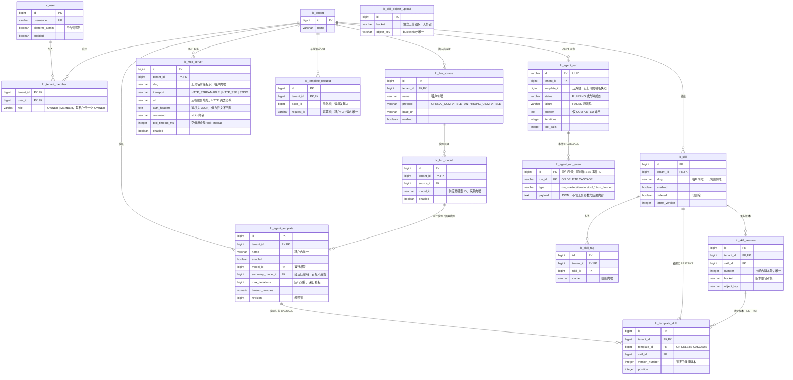

# 数据库表结构总览

本文件是 `backend/sql/` 的结构总览，便于讨论需求时快速查看表关系；列定义、约束与注释以 `backend/sql/<模块>/` 中的建表文件为准。新增或修改表结构时同步更新本文件。

## ER 图

关系线标注外键行为；每表只列主键、唯一键、外键列和关键业务列，完整列定义见对应 SQL 文件。

## 表清单

| 模块 | 表 | 用途 | 建表文件 |
| --- | --- | --- | --- |
| identity | lc_user | 平台账号，密码单向哈希 | `backend/sql/identity/create_user.sql` |
| identity | lc_tenant | 租户 | `backend/sql/identity/create_tenant.sql` |
| identity | lc_tenant_member | 租户成员关系，每租户一个负责人 | `backend/sql/identity/create_tenant_member.sql` |
| llm | lc_llm_source | 租户供应商连接（协议、baseUrl、加密 API Key） | `backend/sql/llm/create_llm_source.sql` |
| llm | lc_llm_model | 来源下的模型目录（能力字段见 add_model_capabilities.sql） | `backend/sql/llm/create_llm_model.sql` |
| skill | lc_skill | 技能元数据，软删除 | `backend/sql/skill/create_skill.sql` |
| skill | lc_skill_version | 技能整包版本，指向对象存储 | `backend/sql/skill/create_skill_version.sql` |
| skill | lc_skill_tag | 技能标签 | `backend/sql/skill/create_skill_tag.sql` |
| skill | lc_skill_object_upload | 上传对象跟踪（清理补偿用，无外键） | `backend/sql/skill/create_skill_object_upload.sql` |
| mcp | lc_mcp_server | 租户 MCP 服务配置（传输、地址/命令、加密鉴权头、超时覆盖） | `backend/sql/mcp/create_mcp_server.sql` |
| template | lc_agent_template | Agent 运行模板（模型、提示词、预算） | `backend/sql/template/create_agent_template.sql` |
| template | lc_template_skill | 模板与技能版本的绑定 | `backend/sql/template/create_template_skill.sql` |
| template | lc_template_request | 模板保存幂等请求记录 | `backend/sql/template/create_template_request.sql` |
| agent | lc_agent_run | Agent 运行记录与终态结果；Redis Stream 仅作实时热通道 | `backend/sql/agent/create_agent_run.sql` |
| agent | lc_agent_run_event | 运行事件流，SSE 断线重放的兜底数据源 | `backend/sql/agent/create_agent_run_event.sql` |

## 初始化顺序

按外键依赖：identity（lc_user → lc_tenant → lc_tenant_member）→ llm（lc_llm_source → lc_llm_model）→ skill（lc_skill → lc_skill_version / lc_skill_tag / lc_skill_object_upload）→ mcp（lc_mcp_server）→ template（lc_agent_template → lc_template_skill / lc_template_request）→ agent（lc_agent_run → lc_agent_run_event）。各模块内顺序见 `backend/sql/<模块>/README.md`。

Agent 运行事件同时写入 lc_agent_run_event（真相源）与 Redis Stream（实时通道，终态后短时保留）；SSE 重放优先读 Stream，缺失或过期时以本表兜底。
